# המוח הצרכני: הפסיכולוגיה שמאחורי החלטות קנייה
## The Consumer Brain: The Psychology Behind Purchasing Decisions

> **קוד פרויקט:** `SHM-2026`  
> **מוסד אקדמי:** אוניברסיטת חיפה  
> **מסגרת אקדמית:** מטלה מספר 1 | קורס סוכני <bdi>AI</bdi> ו-<bdi>Vibe Coding</bdi>  
> **צוות המגישות:**  
> - **שמס סבאג (Shams Sabbagh)** – סטודנטית לפסיכולוגיה, אוניברסיטת חיפה  
> - **מלאק פרוג'ה (Malak Faroj)** – סטודנטית לתקשורת ושיווק, אוניברסיטת חיפה  
> 
> **דרישת סילבוס מפורשת של המרצה:**  
> *"בשורש ה-Repository חובה להציב קובץ README.md. הנחו את ה-LLM לשלב בתוך ה-README צילומי מסך והמחשות ויזואליות מתוך המצגת, הסרטון ותוצרי קוד ה-Python."*

---

## 🎯 1. מטרת הפרויקט והחזון האקדמי (Project Overview & Academic Purpose)

פרויקט **"המוח הצרכני"** מהווה גשר אינטגרטיבי ובינתחומי בין **מדעי המוח והפסיכולוגיה הקוגניטיבית וההתנהגותית** לבין **אסטרטגיות שיווק, מיתוג ופרסום שכנועי**.

הפרויקט פותח במסגרת שיתוף פעולה אקדמי שוויוני ומלא בין שתי סטודנטיות באוניברסיטת חיפה:
- **שמס סבאג (פסיכולוגיה):** מובילת הניתוח המדעי והקוגניטיבי, מודל שתי המערכות, תורת הסיכויים, אפקט העיגון, היוריסטיקות שיפוט, הסמנים הסומטיים, מודלי ה-Python המדעיים והבטחת הדיוק האקדמי לפי תקן APA.
- **מלאק פרוג'ה (תקשורת ושיווק):** מובילת הניתוח השיווקי והתקשורתי, פיתוח מערכת העיצוב החמה (<bdi>Warm Editorial System</bdi>), שילוב מוצרי יוקרה ריאליסטיים (תיק היוקרה של <bdi>Maison Vendôme</bdi> וקטלוג 12 הבשמים), שדרוג פקדי התלת-ממד ומצב החתך בשקופית 8, מעבדת השיווק האתי (<bdi>Dark Patterns</bdi>) ושדרוג דיאגרמות ה-SVG ברזולוציה גבוהה.

מטרת הפרויקט היא לחשוף, להמחיש ולנתח את המנגנונים המנטליים והעצביים המעצבים את בחירות הצרכן בעולם הדיגיטלי והפיזי. באמצעות מצגת אינטראקטיבית בת **20 שקופיות מובנות**, מעבדות התנסותיות חיות, מודל תלת-ממדי אנטומי של המוח, סינתזת מוזיקה עדינה ב-Web Audio API, ומנוע חישוב מדעי מלא ב-Python הרץ ישירות בדפדפן (Pyodide WebAssembly), הפרויקט מפרק הטיות קוגניטיביות, מודד זמני החלטה בזמן אמת, ובוחן באופן ביקורתי את הגבול שבין דחיפה מועילה (<bdi>Nudge</bdi>) לבין מניפולציה מסחרית (<bdi>Dark Patterns</bdi>).

---

## 🎨 2. מערכת העיצוב החזותית: Warm Editorial Design System

המצגת כולה (כל 20 השקופיות) פועלת תחת מערכת עיצוב אחידה, יוקרתית וחמה (**Warm Editorial Academic Design**), המשלבת טיפוגרפיה אקדמית מעודנת, פלטת צבעים עשירה של גוני שמנת, יין, אלמוג ופחם, וכרטיסיות קריאות ומאווררות:

- **קנבס ורקע ראשי:** גון שמנת חם ומאיר (`#F7F3ED` / `#EFE9E0`), המונע סנוור ומעניק תחושת כתב-עת מדעי יוקרתי.
- **משטחים וכרטיסיות (<bdi>Surfaces & Cards</bdi>):** גון נייר חם (`#FCF9F5`), עם מסגרות יין עדינות (`rgba(80, 38, 56, 0.16)`).
- **כותרות והדגשות יסוד:** בורגונדי / יין עמוק ועשיר (`#502638`), המשרה סמכותיות אקדמית.
- **צבעי הדגשה ופעולה (<bdi>Accent Colors</bdi>):** אלמוג חם (`#D85B49` / `#B83D2B`), ירוק מרווה (`#32705C`) להצלחה ואימות, וענבר מוזהב (`#C87A28`).
- **טקסט גוף וקריאות:** פחם רך וקריא (`#252329`) עם טקסט משני בגון גרפיט חם (`#5A5258`), העומד בתקני ניגודיות מחמירים (WCAG AA/AAA).
- **טיפוגרפיה בינתחומית:**
  - **Heebo:** כותרות חדות, ברורות ומודרניות בעברית.
  - **Assistant:** טקסט רץ קריא, אנושי ואקדמי.
  - **JetBrains Mono:** מספרים, זמני שעון עצר, קואורדינטות וקוד מדעי.
- **בידוד לשוני מלא (<bdi>BIDI Isolation</bdi>):** תמיכה מלאה בכיווניות עברית (`dir="rtl"`), תוך בידוד מושלם של מונחים לועזיים, שמות חוקרים ומשוואות מתמטיות באמצעות תגיות `<bdi>`.

---

## 🧠 3. מושגי מפתח בפסיכולוגיה ובשיווק (Core Concepts)

1. **מודל שתי המערכות (<bdi>Dual-Process Theory – Kahneman & Tversky; Stanovich & West, 2000</bdi>):**
   - **מערכת 1:** אינטואיטיבית, מהירה, אוטומטית ומונעת על ידי רגש ואסוציאציות.
   - **מערכת 2:** אנליטית, איטית, מבוקרת, דורשת מאמץ קשבי ומוגבלת ברציונליות חסומה (<bdi>Simon, 1955</bdi>).
2. **קשב חזותי ובולטות תפיסתית (<bdi>Visual Attention & Saliency – Itti & Koch, 2001; Rayner, 1998</bdi>):**
   - סריקת דפי רשת בתבנית <bdi>F-Pattern</bdi>, הטיית מבט ופנים (<bdi>Face Bias</bdi>), ועיוורון באנרים (<bdi>Banner Blindness</bdi>).
3. **שיווק רב-חושי ואינטגרציה חושית (<bdi>Multisensory Integration – Krishna, 2012; Spence, 2011</bdi>):**
   - השפעת צבע, צליל, משקל ומגע על תפיסת הערך והחוויה הצרכנית (<bdi>Cross-Modal Transfer</bdi>).
4. **תיאוריית הסמנים הסומטיים (<bdi>Somatic Marker Hypothesis – Antonio Damasio, 1994</bdi>):**
   - אותות גופניים-רגשיים ("תחושת בטן") המופעלים על ידי האמיגדלה ומשולבים ב-vmPFC לסינון מהיר של חלופות.
5. **רשתות אסוציאציות והפצת הפעלה (<bdi>Spreading Activation – Collins & Loftus, 1975; Keller, 1993</bdi>):**
   - זיכרון סמנטי, זמינות מנטלית (<bdi>Mental Availability</bdi>), ונקודות כניסה לקטגוריה (<bdi>Category Entry Points</bdi>).
6. **נוירואנטומיה של קבלת החלטות (<bdi>Distributed Neural Valuation Networks – Knutson et al., 2007</bdi>):**
   - רשת מבוזרת הכוללת את הרשת הקדם-מצחית (PFC), האמיגדלה (סכנה ודחיפות), האינסולה (עלות/כאב) וגרעין האקומבנס (ציפייה לתגמול ועונג).
7. **אפקט המחסור ו-FOMO (<bdi>Scarcity Effect – Worchel, Lee & Adewole, 1975; Brehm, 1966</bdi>):**
   - תיאוריית ההתנגדות הפסיכולוגית (<bdi>Psychological Reactance</bdi>) ודחיפות קנייה מואצת בתנאי מלאי מוגבל.
8. **פרדוקס הבחירה ועומס קוגניטיבי (<bdi>The Paradox of Choice – Schwartz, 2004; Iyengar & Lepper, 2000</bdi>):**
   - ריבוי חלופות המוביל לשיתוק החלטה (<bdi>Choice Overload</bdi>), הארכת זמני תגובה וחרטה מוקדמת.
9. **אפקט הפיתיון (<bdi>Decoy Effect / Asymmetric Dominance – Huber, Payne & Puto, 1982</bdi>):**
   - הוספת חלופה נחותה באופן אסימטרי המשנה את יחס ההעדפה לטובת מוצר היעד היקר יותר.
10. **הוכחה חברתית וקונפורמיות (<bdi>Social Proof – Cialdini, 2006</bdi>):**
    - הפחתת אי-ודאות וחרדת רכישה באמצעות רמזים נורמטיביים והתנהגות הרוב.
11. **תורת הסיכויים ושנאת הפסד (<bdi>Prospect Theory & Loss Aversion – Kahneman & Tversky, 1979</bdi>):**
    - פונקציית ערך א-סימטרית ($v(x)$) שבה כאב ההפסד חזק פי ~2.25 מעונג הרווח המקביל.
12. **היוריסטיקת העיגון וההתאמה (<bdi>Anchoring and Adjustment – Tversky & Kahneman, 1974</bdi>):**
    - השפעת מחיר ייחוס ראשוני על הערכת השווי הכלכלי של מוצר.
13. **כאב התשלום (<bdi>The Pain of Paying – Prelec & Loewenstein, 1998</bdi>):**
    - צימוד מנטלי של תשלום לצריכה והפחתת חיכוך כספי בארנקים דיגיטליים ורכישה ב-1-Click.
14. **שיווק אתי מול דפוסי חושך (<bdi>Ethical Nudging vs. Dark Patterns – Thaler & Sunstein, 2008; Brignull, 2010</bdi>):**
    - שקיפות ואוטונומיה צרכנית לעומת הטיית ברירת מחדל (<bdi>Default Effect – Johnson & Goldstein, 2003</bdi>) וביוש צרכנים (<bdi>Confirmshaming</bdi>).
15. **פרסום רגשי ופער עמדה-התנהגות (<bdi>Emotional Advertising & Attitude-Behavior Gap – Petty & Cacioppo, 1986</bdi>):**
    - השפעת מסרים רגשיים על חיבור למותג מול התמתנות כוונת הקנייה בפועל עקב מגבלות תקציב ומחיר.

---

## 📸 4. גלריית צילומי מסך מאומתים מתוך המצגת (Visual Showcase)

כלל צילומי המסך להלן נלכדו ברזולוציה גבוהה (`1440x900`) ישירות מתוך המצגת הפועלת, ומציגים את השילוב המדויק בין הפילוסופיה העריכתית החמה, הדיאגרמות הוקטוריות, מודל התלת-ממד והמעבדות האינטראקטיביות:

### שקופיות שער ומבוא (שקופיות 1–2)
| שקופית 1 – שער הפרויקט (`consumer_brain_hero.jpg`) | שקופית 2 – מבוא וגבולות המדע |
| :---: | :---: |
| [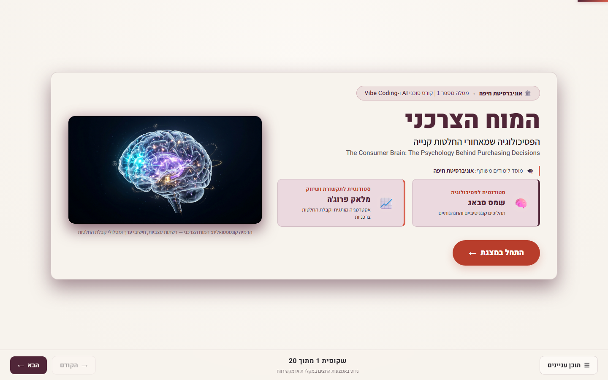](docs/screenshots/slide01_welcome.png) | [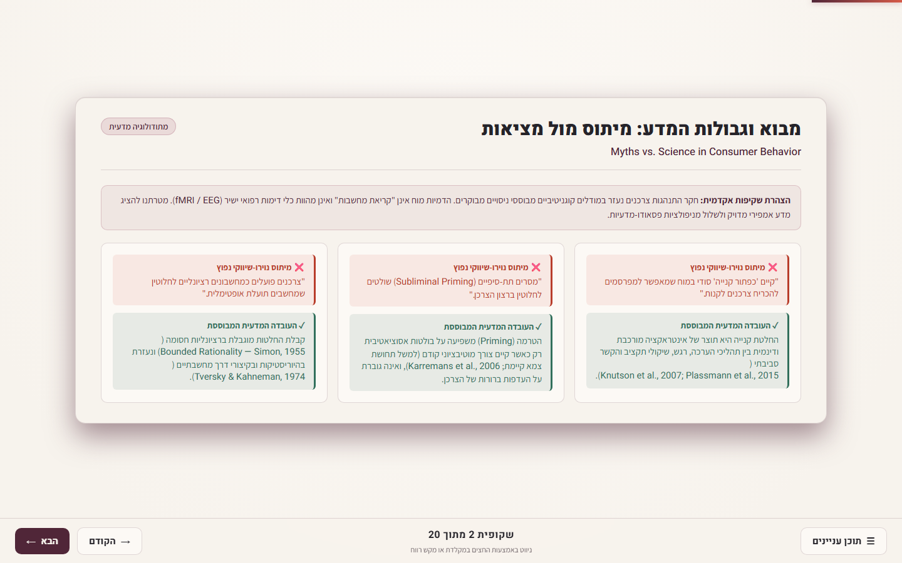](docs/screenshots/slide02_foundations.png) |
| *שער הפרויקט המציג את תמונת המוח הנוירו-גרפית, כותרת המחקר, שיוך שוויוני לשתי המגישות (שמס סבאג ומלאק פרוג'ה) ואוניברסיטת חיפה.* | *הבחנה אקדמית מתודולוגית בין עובדות נוירו-שיווקיות מבוססות לבין מיתוסים מסחריים.* |

---

### דיאגרמות וקטוריות עשירות ברזולוציה גבוהה (שקופיות 3–7)
דיאגרמות ה-SVG פותחו ברזולוציה של `1100x560` ומכילות מראי מקום אקדמיים מדויקים בעיצוב Warm Editorial מוקפד:

| שקופית 3 – מודל שתי המערכות | שקופית 4 – קשב חזותי ומעקב עיניים |
| :---: | :---: |
| [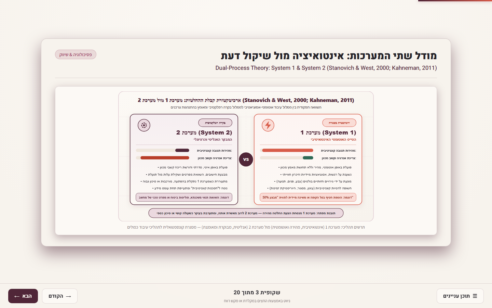](docs/screenshots/slide03_dual_system.png) | [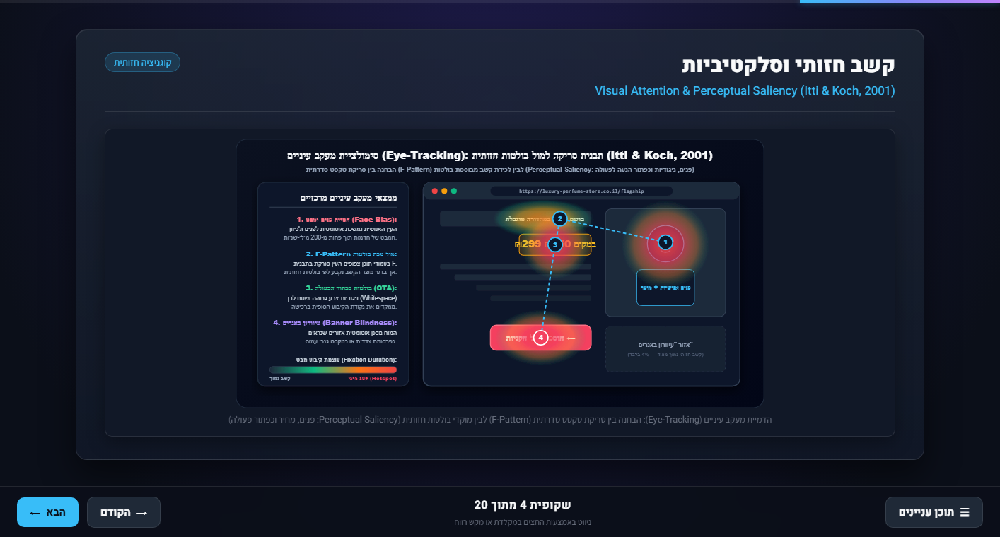](docs/screenshots/slide04_visual_attention.png) |
| *מערכת 1 (אינטואיטיבית ומהירה) מול מערכת 2 (אנליטית ומבוקרת).* | *סימולציית Eye-Tracking: סריקת F-Pattern מול מפת בולטות חזותית.* |

| שקופית 5 – תפיסה ואינטגרציה רב-חושית | שקופית 6 – תיאוריית הסמנים הסומטיים |
| :---: | :---: |
| [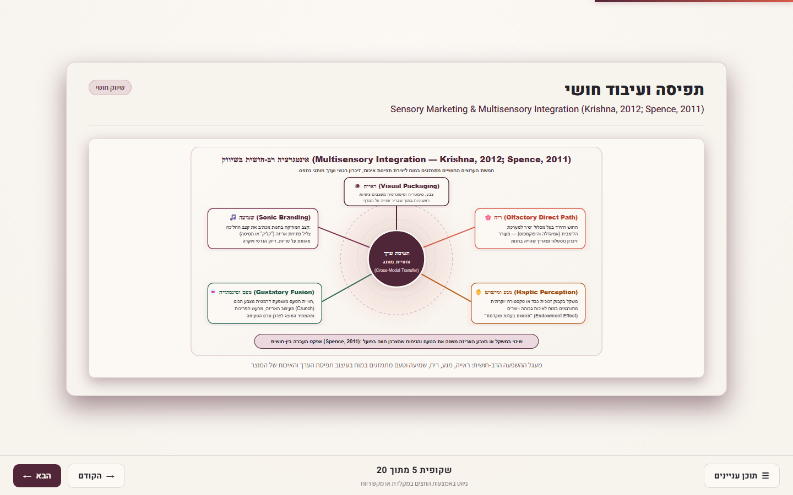](docs/screenshots/slide05_sensory_marketing.png) | [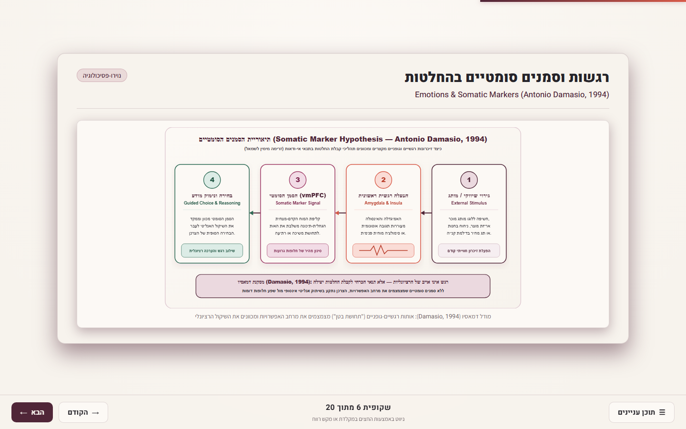](docs/screenshots/slide06_somatic_markers.png) |
| *5 ערוצי החושים המתמזגים במוח לעיצוב תפיסת ערך ואיכות המוצר.* | *מודל דמאסיו: 4 שלבי הסמן הסומטי בתהליך RTL מימין לשמאל.* |

| שקופית 7 – רשתות אסוציאציות בזיכרון המותג |
| :---: |
| [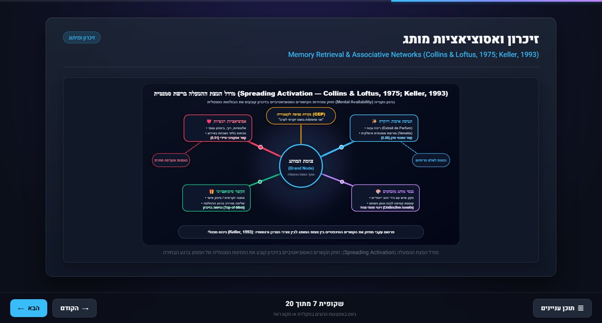](docs/screenshots/slide07_associative_networks.png) |
| *מודל הפצת ההפעלה: צומת מותג מרכזי, נקודת כניסה לקטגוריה (CEP) ו-4 אשכולות סמנטיים.* |

---

### מודל המוח התלת-ממדי האנטומי (שקופית 8)
מודל Three.js מבוסס על אטלס אנטומי פתוח (*Brainder.org, FreeSurfer DK & ASEG, CC BY-SA 3.0*) עם 85,219 פוליגונים, גרירה ב-2 צירים, זום, ופקדי שליטה מתקדמים:

| שקופית 8 – מודל המוח האנטומי (מבט חיצוני) | שקופית 8 – שקיפות חתך (Cutaway) ובחירת אזור מוחי |
| :---: | :---: |
| [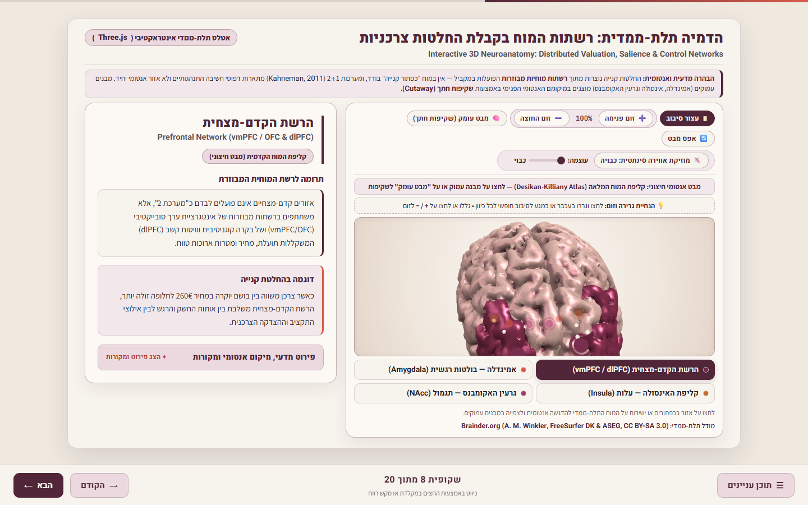](docs/screenshots/slide08_brain3d.png) | [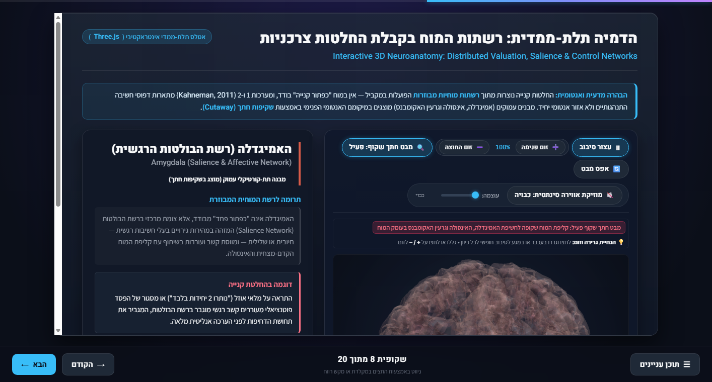](docs/screenshots/slide08_brain3d_cutaway.png) |
| *קליפת המוח החיצונית עם פקדי זום (+/-), עצירת סיבוב ואיפוס מבט.* | *מצב Cutaway חושף מבנים תת-קורטיקליים עמוקים (אמיגדלה, אינסולה, NAcc).* |

---

### מעבדות אינטראקטיביות וחישובי Python (שקופיות 9, 10, 13, 14, 16)
| שקופית 9 – אפקט המחסור (תיק יוקרה Maison Vendôme) | שקופית 10 – פרדוקס הבחירה (שעון עצר דיגיטלי חי) |
| :---: | :---: |
| [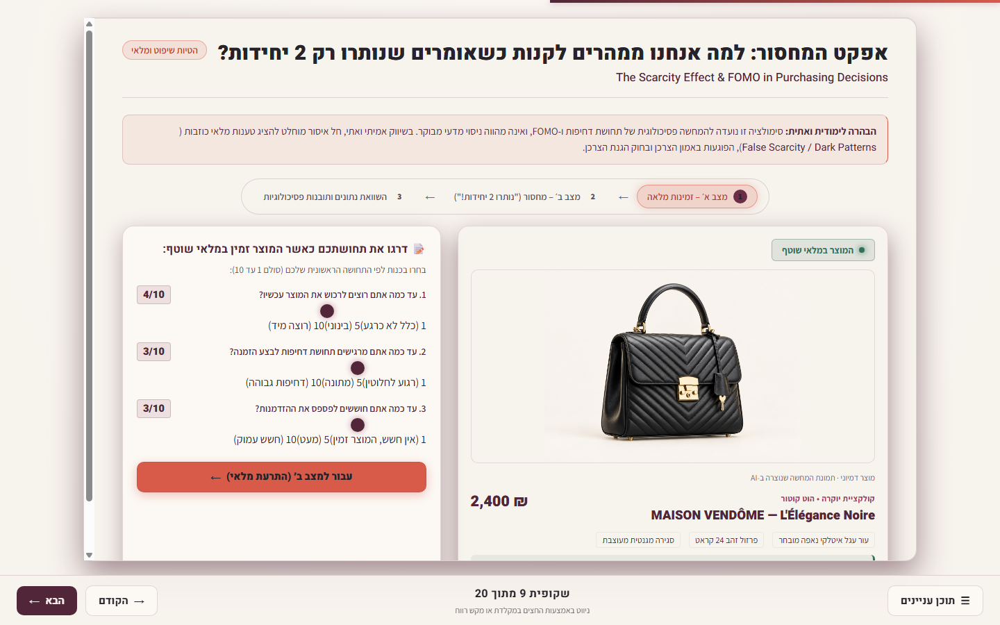](docs/screenshots/slide09_scarcity_active.png) | [](docs/screenshots/slide10_choice_active.png) |
| *תיק יוקרה MAISON VENDÔME במצב "נותרו רק 2 יחידות במלאי!", סליידרים והשוואת Python.* | *ניסוי שעון עצר דיגיטלי חי: מדידת זמן בחירה ב-3 מול קטלוג 12 בשמים מעוצב.* |

| שקופית 13 – תורת הסיכויים ועקומת S | שקופית 14 – אפקט העיגון וחישוב שווי ב-Python |
| :---: | :---: |
| [](docs/screenshots/slide13_prospect_theory.png) | [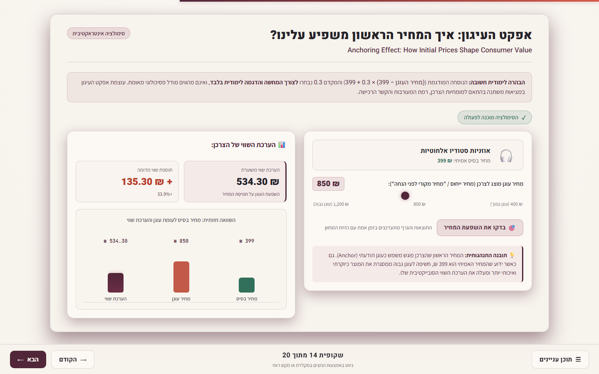](docs/screenshots/slide14_anchoring_calculated.png) |
| *עקומת S אינטראקטיבית: הדגמת שנאת הפסד ביחס של פי 2.25 עם נקודה נעה.* | *חישוב CPython WebAssembly של הערכת שווי תחת מחיר עוגן משתנה.* |

| שקופית 16 – שיווק אתי מול דפוסי חושך |
| :---: |
| [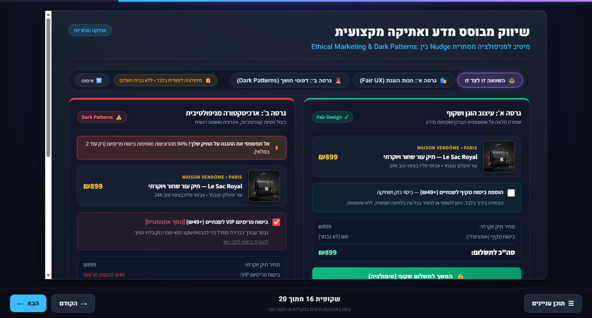](docs/screenshots/slide16_dark_patterns.png) |
| *מעבדת Checkout השוואתית: חנות הוגנת מול חנות מניפולטיבית עם מודאל Confirmshaming.* |

---

### עקרונות התנהגותיים נוספים (שקופיות 11, 12, 15, 17, 18)
| שקופית 11 – אפקט הפיתיון | שקופית 12 – הוכחה חברתית | שקופית 15 – כאב התשלום |
| :---: | :---: | :---: |
| [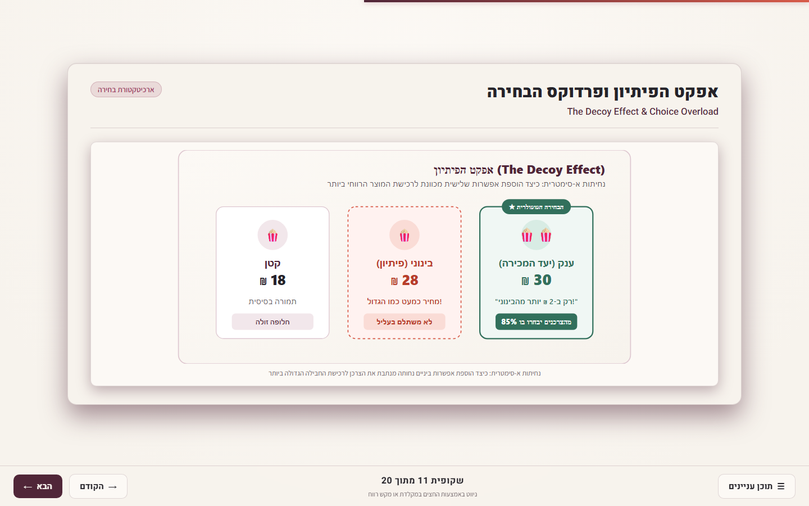](docs/screenshots/slide11_loss_aversion.png) | [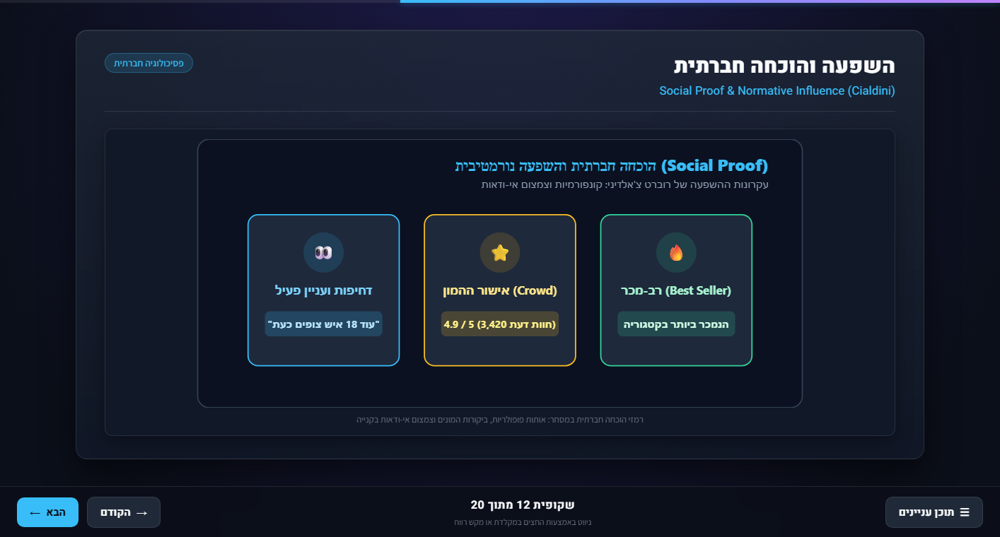](docs/screenshots/slide12_social_proof.png) | [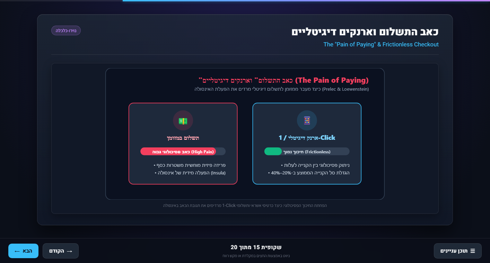](docs/screenshots/slide15_framing_effect.png) |

| שקופית 17 – סוכני AI ועתיד הרכישה | שקופית 18 – סיכום ותובנות יישומיות | שקופית 20 – ביבליוגרפיה ורישוי |
| :---: | :---: | :---: |
| [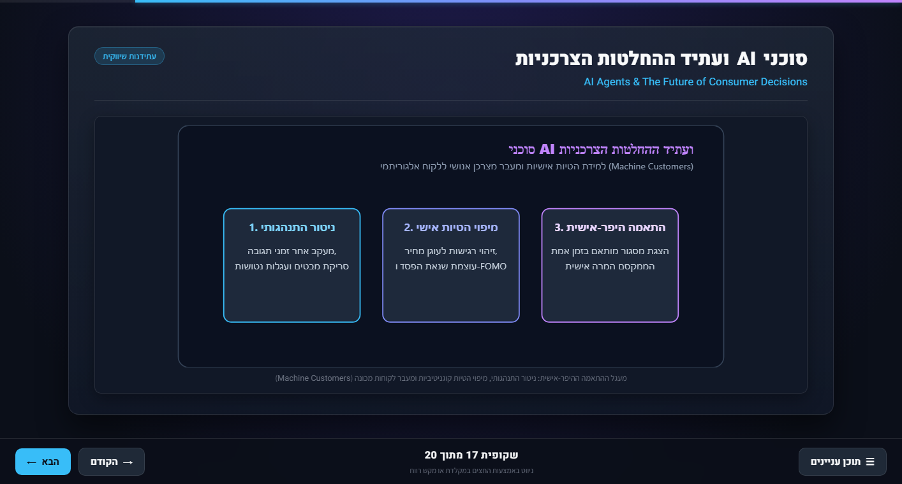](docs/screenshots/slide17_neuropricing.png) | [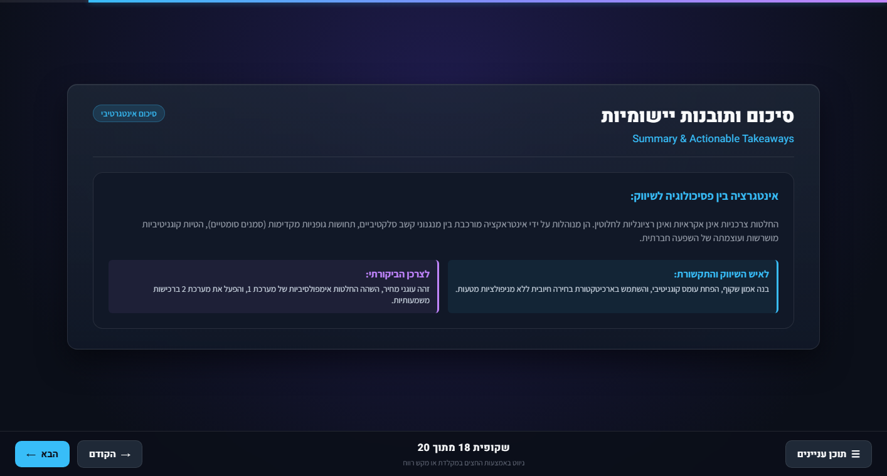](docs/screenshots/slide18_ethical_nudging.png) | [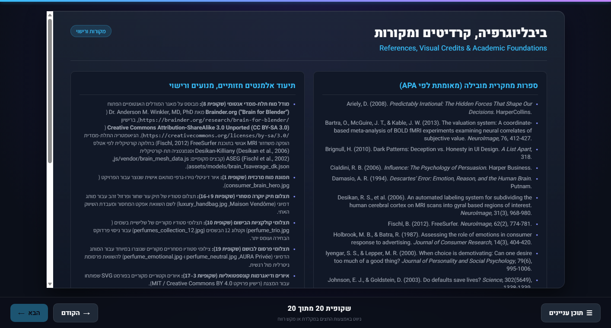](docs/screenshots/slide20_references.png) |

---

### מעבדת פרסום רגשי – ניסוי AURA Privée המקורי (שקופית 19)
ניסוי A/B תלת-שלבי מובנה להשוואת מודעה ניטרלית מול מודעה רגשית עבור בושם היוקרה `AURA Privée`:

| שלב 1: מודעה ניטרלית | שלב 2: מודעה רגשית עם מוזיקת אווירה | שלב 3: גרף תוצאות ופער עמדה-קנייה |
| :---: | :---: | :---: |
| [](docs/screenshots/slide19_emotional_ad_neutral.png) | [](docs/screenshots/slide19_emotional_ad_emotional.png) | [](docs/screenshots/slide19_emotional_ad_results.png) |
| *תאורת סטודיו מאוזנת, מפרט טכני עובדתי, דירוג סליידרים.* | *תאורת שקיעה, מסר רגשי ומוזיקת אווירה הרמונית ב-Web Audio.* | *גרף עמודות השוואתי ב-Python וניתוח פער עמדה-התנהגות.* |

---

## 📊 5. סקירה מקיפה של כל 20 השקופיות (Slide-by-Slide Matrix)

| # | כותרת השקופית | תחום ידע מרכזי | מדיה ונכסים חזותיים | אינטראקציה ומנוע חישוב |
| :-: | :--- | :--- | :--- | :--- |
| **1** | **המוח הצרכני** | שער, זהות הצוות ושיוך לאוניברסיטת חיפה | `consumer_brain_hero.jpg` | כפתור התחלת מצגת, סרגל ניווט עליון, קיצורי מקלדת |
| **2** | **מבוא וגבולות המדע** | מתודולוגיה אקדמית והפרכת מיתוסים נוירו-שיווקיים | כרטיסיות מיתוס מול עובדה | קריאה מובנית, ציטוט Knutson et al., תיבת שקיפות מדעית |
| **3** | **מודל שתי המערכות** | מערכת 1 (מהירה) מול מערכת 2 (מבוקרת) | דיאגרמה וקטורית `dual_system.svg` | תרשים ארכיטקטורה ודוגמאות צרכניות (Kahneman & Tversky) |
| **4** | **קשב חזותי וסלקטיביות** | F-Pattern, בולטות חזותית ומעקב עיניים | דיאגרמה וקטורית `visual_attention_heatmap.svg` | הדמיית מעקב עיניים ודפדפן חנות (Itti & Koch) |
| **5** | **תפיסה ועיבוד חושי** | שיווק רב-חושי ואינטגרציה בין-חושית | דיאגרמה וקטורית `sensory_wheel.svg` | גלגל חושים וניתוח מעבר בין-חושי (Krishna; Spence) |
| **6** | **רגשות וסמנים סומטיים** | תיאוריית דמאסיו ואותות גופניים-רגשיים | דיאגרמה וקטורית `somatic_marker.svg` | תהליך 4 שלבים מימין לשמאל (RTL) |
| **7** | **זיכרון ואסוציאציות מותג** | רשתות אסוציאטיביות ומודל הפצת הפעלה | דיאגרמה וקטורית `brand_associative_network.svg` | צומת מותג ו-4 אשכולות סמנטיים (Collins & Loftus) |
| **8** | **הדמיה תלת-ממדית: רשתות המוח** | נוירואנטומיה של קבלת החלטות צרכניות | מודל 3D אנטומי `Three.js` (85k משולשים) + גיבוי | גרירה ב-2 צירים, זום `+`/`-`, חתך Cutaway, 4 אזורים ותדרי קול |
| **9** | **אפקט המחסור ו-FOMO** | FOMO, מלאי מוגבל ותיאוריית ההתנגדות | תצלום תיק יוקרה `handbag_editorial.png` | **מעבדת A/B חיה (Maison Vendôme) + מנוע Python** |
| **10** | **פרדוקס הבחירה** | עומס קוגניטיבי, שיתוק החלטה וחרטה | קטלוג 12 בשמים `perfume_catalog_editorial.png` | **ניסוי שעון עצר דיגיטלי חי (3 מול 12) + מודאל + Python** |
| **11** | **אפקט הפיתיון** | שליטה אסימטרית והטיית אפשרויות | דיאגרמה וקטורית `decoy_effect.svg` | ניתוח הוספת חלופה נחותה א-סימטרית (Huber et al.) |
| **12** | **השפעה והוכחה חברתית** | קונפורמיות, אמון והפחתת אי-ודאות | דיאגרמה וקטורית `social_proof.svg` | ניתוח רמזים נורמטיביים ודירוגי קהל (Cialdini) |
| **13** | **תורת הסיכויים** | שנאת הפסד ופונקציית ערך א-סימטרית | עקומת S אינטראקטיבית מבוססת SVG | **בורר רווח/הפסד + נקודה נעה + חישוב ערך ב-Python** |
| **14** | **אפקט העיגון** | היוריסטיקת עיגון והתאמה בקביעת מחיר | גרף עמודות השוואתי דינמי | **מחוון עוגן (₪400–1,200) + כפתור חישוב ב-Python** |
| **15** | **כאב התשלום** | צימוד מנטלי, אינסולה וארנקים דיגיטליים | דיאגרמה וקטורית `pain_of_paying.svg` | השוואת מזומן לאשנק דיגיטלי ורכישה ב-1-Click |
| **16** | **שיווק אתי ודפוסי חושך** | שיווק הוגן מול מניפולציות Dark Patterns | תצלום יוקרה `handbag_editorial.png` | **מעבדת Checkout השוואתית + מודאל Confirmshaming + Python** |
| **17** | **סוכני AI ועתיד ההחלטות** | סוכנים אוטונומיים ופרסונליזציית-על | דיאגרמה וקטורית `ai_decision_loop.svg` | ניתוח מעגל ההחלטה העתידני וסוכנים קונים |
| **18** | **סיכום ותובנות יישומיות** | עקרונות יישומיים לצרכנים ולמשווקים | כרטיסיות סיכום מודולריות | כללי אצבע צרכניים ואתיים לאנשי מקצוע ולצרכנים |
| **19** | **פרסום רגשי מול ניטרלי** | ניסוי A/B בבושם AURA Privée | תצלומי סטודיו ניטרלי ורגשי | **ניסוי 3 שלבים + מוזיקת אווירה ב-Web Audio + מנוע Python** |
| **20** | **ביבליוגרפיה ומקורות** | מקורות אקדמיים מאומתים ורישוי נכסים | כרטיסיות ביבליוגרפיה מובנות | סקירת ספרות מלאה (APA) ורישוי FreeSurfer / Three.js |

---

## 🔬 6. פירוט מודלי ה-Python המדעיים (Python Scientific Models)

בפרויקט פועלים 6 מודלי Python מדעיים מאומתים הרצים ישירות בדפדפן באמצעות **Pyodide WebAssembly (CPython v3.11)**, עם מנגנון גיבוי מתמטי מלא ב-JavaScript:

1. **שקופית 9 (אפקט המחסור):**  
   פונקציה: `calculate_scarcity_comparison(ratings_a, ratings_b)`  
   מחשבת את מכפיל המחסור המשוקלל ($\Delta_{\text{scarcity}}$) על בסיס רמת רצון, דחיפות ו-FOMO:
   $$\text{Multiplier} = \frac{\text{Mean}(R_B)}{\text{Mean}(R_A)}$$
2. **שקופית 10 (פרדוקס הבחירה):**  
   פונקציה: `calculate_choice_paradox(round_1, round_2)`  
   מנתחת זמני החלטה חיים מתוך הסטופר הדיגיטלי ($T_2 / T_1$) ומשקללת את מדד העומס הקוגניטיבי מול דירוגי הקושי הסובייקטיביים.
3. **שקופית 13 (תורת הסיכויים):**  
   פונקציה: `calculate_prospect_theory(amount, is_gain)`  
   מימוש מדויק של פונקציית הערך הא-סימטרית של כהנמן וטברסקי:
   $$v(x) = \begin{cases} x^{0.88} & x \ge 0 \\ -2.25 \cdot (-x)^{0.88} & x < 0 \end{cases}$$
4. **שקופית 14 (אפקט העיגון):**  
   פונקציה: `calculate_anchoring(anchor_price)`  
   חישוב הערכת שווי מותאמת תחת עוגן ביחס למחיר בסיס (₪399):
   $$\text{Estimated Value} = 399 + 0.3 \cdot (\text{Anchor} - 399)$$
5. **שקופית 16 (שיווק אתי ודפוסי חושך):**  
   פונקציה: `calculate_dark_patterns_ethics(store_type, insurance_selected)`  
   חישוב פערי אוטונומיה ושקיפות והסתברות בחירה בברירת מחדל (<bdi>Johnson & Goldstein, 2003</bdi>): 100% אוטונומיה בחנות ההוגנת מול 35% בלבד בחנות המניפולטיבית.
6. **שקופית 19 (פרסום רגשי מול ניטרלי):**  
   פונקציה: `calculate_emotional_ad_comparison(ad_a_ratings, ad_b_ratings)`  
   ניתוח השוואתי רב-ממדי של עמדה מותגית וחישוב פער העמדה-התנהגות (<bdi>Attitude-Behavior Gap</bdi>) לפי מודל ה-ELM של פטי וקצ'יופו (1986).

---

## 💻 7. טכנולוגיות וארכיטקטורה (Technologies & Architecture)

1. **HTML5 Semantic & Native BIDI/RTL:**
   - 20 שקופיות סמנטיות מלאות (`<section class="slide" id="slide-X">`).
   - התאמה מוחלטת לכיווניות עברית (`dir="rtl"`) ובידוד מונחים לועזיים בתגיות `<bdi>`.
2. **Modern CSS3 Warm Editorial System:**
   - ארכיטקטורת משתני CSS (`--ed-bg`, `--ed-burgundy`, `--ed-coral`, `--ed-surface`) המאפשרת אחידות חזותית מושלמת.
   - התאמה רספונסיבית מלאה למחשבים ניידים, מסכים רחבים, טאבלטים ומכשירים ניידים.
3. **Vanilla JavaScript (ES6+ Modular Architecture):**
   - 9 מודולים עצמאיים, קריאים וללא ספריות Framework חיצוניות:
     - [`js/presentation.js`](js/presentation.js) – בקר ניווט, מקלדת, מגע, היסטוריית שקופיות ותוכן עניינים (TOC).
     - [`js/audio.js`](js/audio.js) – סינתזה מוזיקלית פרוצדורלית ותדרי אזורים ב-Web Audio API.
     - [`js/brain3d.js`](js/brain3d.js) – בקר מודל המוח התלת-ממדי ב-Three.js, גרירה בשני צירים ומצב חתך.
     - [`js/python_runner.js`](js/python_runner.js) – מנהל סביבת CPython WebAssembly (Pyodide) ומנגנוני Fallback.
     - [`js/scarcity_sim.js`](js/scarcity_sim.js) – לוגיקת מעבדת אפקט המחסור בתיק Maison Vendôme (שקופית 9).
     - [`js/choice_paradox.js`](js/choice_paradox.js) – ניסוי פרדוקס הבחירה, שעון עצר דיגיטלי חי וגריד הבשמים (שקופית 10).
     - [`js/prospect_theory.js`](js/prospect_theory.js) – לוגיקת תורת הסיכויים ועקומת S ב-SVG (שקופית 13).
     - [`js/ethical_marketing.js`](js/ethical_marketing.js) – מעבדת שיווק אתי, מודאל Confirmshaming ושאלת אבחון (שקופית 16).
     - [`js/emotional_ad.js`](js/emotional_ad.js) – מעבדת פרסום רגשי AURA Privée (שקופית 19).
4. **Three.js WebGL Engine (`js/vendor/three.min.js`):**
   - רינדור מקומי מואץ חומרה, רשת אנטומית בת 85,219 מצולעים (CC BY-SA 3.0), גרירה ב-2 צירים, זום דיגיטלי ומצב חתך Cutaway.
5. **Web Audio API Ambient Synthesizer:**
   - סינתזת מוזיקת אווירה עדינה בזמן אמת, מושתקת כברירת מחדל בהתאם לתקני הדפדפנים, ותדרי שמע ייחודיים ל-4 אזורי מוח.
6. **Pyodide WebAssembly (Client-Side CPython v3.11):**
   - הרצת 6 מודלי Python מדעיים ישירות בדפדפן הלקוח.

---

## 📁 8. מבנה התיקיות והקבצים בפרויקט (Repository Structure)

```text
SHM-2026/
├── index.html                   # ממשק המצגת הראשי (20 שקופיות סמנטיות מלאות בעיצוב Warm Editorial)
├── README.md                    # תיעוד פרויקט מקיף, גלריית צילומי מסך, מדריכי הפעלה והיסטוריית תרומות
├── PRD.md                       # מסמך אפיון דרישות המוצר (Product Requirements Document v3.0)
├── .gitattributes               # הגדרות ניהול שורות Git
├── assets/
│   ├── images/                  # נכסי מדיה חזותיים מאומתים
│   │   ├── consumer_brain_hero.jpg         # תמונת שער נוירו-גרפית מקורית לשקופית 1
│   │   ├── hero_brain_diagram.jpg          # תרשים מוח אנטומי וגיבוי לשקופית 8
│   │   ├── handbag_editorial.png           # תצלום יוקרה ריאליסטי לתיק Maison Vendôme (שקופיות 9 ו-16)
│   │   ├── perfume_catalog_editorial.png   # קטלוג ספרייט של 12 בשמי יוקרה לשקופית 10
│   │   ├── perfume_neutral.jpg             # מודעה ניטרלית לבושם AURA Privée לשקופית 19
│   │   ├── perfume_emotional.jpg           # מודעה רגשית לבושם AURA Privée לשקופית 19
│   │   ├── dual_system.svg                 # דיאגרמת שתי המערכות (1100x560, שקופית 3)
│   │   ├── visual_attention_heatmap.svg    # דיאגרמת מעקב עיניים וקשב (1100x560, שקופית 4)
│   │   ├── sensory_wheel.svg               # דיאגרמת גלגל החושים (1100x560, שקופית 5)
│   │   ├── somatic_marker.svg              # דיאגרמת סמנים סומטיים (1100x560, שקופית 6)
│   │   ├── brand_associative_network.svg   # דיאגרמת רשת אסוציאציות (1100x560, שקופית 7)
│   │   ├── decoy_effect.svg                # דיאגרמת אפקט הפיתיון (שקופית 11)
│   │   ├── social_proof.svg                # דיאגרמת הוכחה חברתית (שקופית 12)
│   │   ├── prospect_theory_curve.svg       # עקומת S אינטראקטיבית לתורת הסיכויים (שקופית 13)
│   │   ├── anchoring_effect.svg            # גרף אפקט העיגון (שקופית 14)
│   │   ├── pain_of_paying.svg              # דיאגרמת כאב התשלום (שקופית 15)
│   │   ├── nudge_vs_darkpattern.svg        # דיאגרמת שיווק אתי (שקופית 16)
│   │   └── ai_decision_loop.svg            # דיאגרמת מעגל החלטות AI (שקופית 17)
│   └── models/
│       └── brain_fsaverage_dk.json         # נתוני קואורדינטות המוח האנטומי
├── css/
│   └── style.css                # מערכת העיצוב הראשית (Warm Editorial, משתני --ed-*, BIDI/RTL)
├── docs/
│   ├── content-audit.md         # ביקורת דיוק מחקרי ועובדתי
│   ├── lecturer-requirements-checklist.md  # צ'ק-ליסט אימות מול דרישות המרצה
│   └── screenshots/             # 27 צילומי מסך מאומתים מכל 20 השקופיות ומצבי האינטראקציה
│       ├── slide01_welcome.png ... slide20_references.png
│       ├── slide08_brain3d_cutaway.png
│       ├── slide09_scarcity_active.png
│       ├── slide10_choice_active.png
│       ├── slide14_anchoring_calculated.png
│       └── slide19_emotional_ad_*.png
├── js/
│   ├── presentation.js          # בקר המצגת, ניווט מקלדת והגנת סליידרים
│   ├── audio.js                 # מנוע שמע סינתטי ב-Web Audio API
│   ├── brain3d.js               # בקר מודל תלת-ממד ב-Three.js (גרירה ב-2 צירים, זום, חתך)
│   ├── python_runner.js         # מנוע הרצת Python ב-Pyodide ו-Fallback מתמטי
│   ├── scarcity_sim.js          # סימולציית אפקט המחסור (Maison Vendôme)
│   ├── choice_paradox.js        # ניסוי פרדוקס הבחירה ושעון עצר דיגיטלי חי
│   ├── prospect_theory.js       # סימולציית תורת הסיכויים ועקומת S
│   ├── ethical_marketing.js     # מעבדת שיווק אתי, Dark Patterns ו-Confirmshaming
│   ├── emotional_ad.js          # מעבדת פרסום רגשי AURA Privée
│   └── vendor/
│       ├── three.min.js         # מנוע Three.js WebGL מקומי
│       └── brain_mesh_data.js   # נתוני רשת המוח האנטומי (CC BY-SA 3.0)
└── prompts/                     # תיעוד אותנטי מלא של כל 29 שלבי הפיתוח המדורגים
```

---

## 🚀 9. הוראות הפעלה מקומית (How to Run)

הפרויקט בנוי לפעולה עצמאית ומיידית ללא צורך בהתקנת שרת Backend חיצוני:

1. **פתיחה ישירה בדפדפן:**
   - שכפלו או הורידו את המאגר (`git clone https://github.com/shamssabbagh/SHM-2026.git`).
   - לחצו לחיצה כפולה על הקובץ [`index.html`](index.html) לפתיחה בכל דפדפן מודרני (**Google Chrome, Microsoft Edge, Mozilla Firefox, Apple Safari**).
2. **הפעלה באמצעות שרת מקומי קל (מומלץ):**
   - ניתן להפעיל שרת מקומי סטטי קל מתיקיית הפרויקט:
     ```powershell
     # באמצעות Node.js:
     npx serve .
     # או באמצעות Python:
     python -m http.server 8080
     ```
   - פתחו את הכתובת `http://127.0.0.1:8080` בדפדפן.
3. **מקשי ניווט במקלדת ובמגע:**
   - `חץ שמאלה` / `רווח` / `Page Down` – מעבר לשקופית הבאה.
   - `חץ ימינה` / `Page Up` – חזרה לשקופית הקודמת.
   - `Home` – מעבר מהיר לשקופית 1.
   - `End` – מעבר מהיר לשקופית 20.
   - במסכי מגע: החלקת אצבע ימינה ושמאלה (<bdi>Swipe</bdi>).
4. **הגנת מקלדת על סליידרים ושדות קלט:**
   - בקר הניווט (`js/presentation.js`) מגן על המשתמש: הזזת מחוונים (Sliders) באמצעות מקשי החצים אינה מעבירה שקופית, ומאפשרת כיול ערכים עדין ללא הפרעה.
5. **שליטה בשמע:**
   - השמע מושתק כברירת מחדל בהתאם לתקני הדפדפנים. ניתן להפעיל מוזיקת אווירה סינתטית בלחיצה על כפתור השמע בסרגל העליון או בשקופיות הייעודיות (8 ו-19).
6. **אימות ביצועי Python בקונסול הדפדפן (לבודקים ומרצים):**
   - לחצו על `F12` (או `Ctrl + Shift + I` / `Cmd + Option + I`), עברו ללשונית **Console**, והקלידו:
     ```javascript
     verifyPythonExecution()
     ```
   - תוצג תוצאת JSON חיה המאשרת הרצת CPython WebAssembly עבור כל 6 מודלי ה-Python במצגת.

---

## ♿ 10. נגישות והתאמה רספונסיבית (Accessibility & Responsive Design)

- **תאימות RTL מלאה:** עימוד מותאם לכיווניות עברית מלאה מימין לשמאל, עם בידוד מונחים לועזיים באמצעות תגיות `<bdi>`.
- **תקני נגישות ARIA:** כרטיסיות ומקטעים מלווים בתגיות `aria-label`, `aria-live="polite"` לעדכוני תוצאות חישוב בזמן אמת, ו-`aria-hidden="true"` לאלמנטים דקורטיביים.
- **ניגודיות צבעים (WCAG AA/AAA):** טקסט פחם כהה (`#252329`) וכותרות יין עמוקות (`#502638`) על גבי רקע שמנת חם (`#F7F3ED` / `#FCF9F5`) מבטיחים חוויית קריאה נוחה וקריאות עילאית.
- **הפחתת תנועה (Reduced Motion):** כיבוד העדפות מערכת ההפעלה לצמצום אנימציות (`prefers-reduced-motion: reduce`).

---

## 🤝 11. תהליך העבודה ושיתוף הפעולה ב-GitHub (Collaboration Workflow)

תהליך הפיתוח התנהל בשיתוף פעולה אקדמי והנדסי הדוק, שוויוני ומבוקר באמצעות Git ו-GitHub, תוך מעקב מדויק אחר כל ענף, Commit ו-Pull Request:

- **ענף ראשי (`main`):** ענף היציבות וההגשה הסופית.
- **ענפי פיתוח ושיפורים (`malak-improvments`):** ענף שבו פותחו שדרוגי מודל המוח התלת-ממדי, פקדי התלת-ממד, והשדרוג הוויזואלי של דיאגרמות ה-SVG.
- **אינטגרציית תרומות מאומתת מתוך היסטוריית ה-Git:**
  - **שמס סבאג (פסיכולוגיה):** ארכיטקטורת התוכן המדעי, מודל שתי המערכות, תורת הסיכויים, אפקט העיגון, היוריסטיקות שיפוט, סמנים סומטיים, מודלי ה-Python המדעיים והבטחת הדיוק האקדמי לפי תקן APA.
  - **מלאק פרוג'ה (תקשורת ושיווק):** פיתוח שפת העיצוב החמה (Warm Editorial), תיק היוקרה של Maison Vendôme בשקופית 9, קטלוג 12 הבשמים ושעון העצר בשקופית 10, פקדי התלת-ממד (גרירה ב-2 צירים, זום, חתך אנטומי) בשקופית 8, מעבדת השיווק האתי בשקופית 16 ודיאגרמות ה-SVG ברזולוציה גבוהה.
- **אבני דרך מרכזיות בהיסטוריית ה-Git:**
  - **PR #1 (`3b69cc3` / `25b717c`):** תוכנית שיפורים מדורגת, תשתית תיעוד וחישובי Python.
  - **Commits `2d19ea8` & `8cb62c0`:** ביקורת מול דרישות המרצה (שיעור 2 סעיף 11) – תיקון המרות Pyodide Map, יחס תצוגה Three.js והגנת מקלדת על סליידרים.
  - **PR #2 (`c7ada3d` / `4e69e51`):** שדרוג מודל המוח בשקופית 8 (מודל אנטומי CC BY-SA 3.0, שקיפות חתך Cutaway, שקט כברירת מחדל).
  - **PR #3 (`19e0e24` / `82851bc`):** שדרוג פקדי התלת-ממד בשקופית 8 (גרירה ב-2 צירים, תמיכה במגע, כפתורי זום, איפוס מבט ועצירת סיבוב).
  - **PR #4 (`05c6415` / `f9aabfd`):** הרחבה ושדרוג אקדמי של 5 דיאגרמות ה-SVG בשקופיות 3–7 ברזולוציה גבוהה (`1100x560`).
  - **PR #5 (`d72159d` / `831c293`):** פיתוח ענף `malak-improvments` – שדרוג נכסי מוצרים (תיק Maison Vendôme, קטלוג 12 בשמים ושעון עצר).
  - **Commit `84366cf` (שילוב סופי ומאושר):** הטמעת מערכת העיצוב החמה (Warm Editorial) באופן אחיד ומלא בכל 20 השקופיות, תיקון סיומות קבצים, שילוב מלא של נכסי מלאק בשקופיות 9 ו-10, אימות 0 שגיאות קונסול ואישור סופי להגשה.

---

## 📚 12. מקורות אקדמיים ורישוי נכסים (References & Credits)

- **Ariely, D. (2008).** *Predictably Irrational: The Hidden Forces That Shape Our Decisions*. HarperCollins.
- **Brignull, H. (2010).** *Dark Patterns: Deception vs. Honesty in UI Design*. A List Apart.
- **Cialdini, R. B. (2006).** *Influence: The Psychology of Persuasion*. Harper Business.
- **Collins, A. M., & Loftus, E. F. (1975).** A spreading-activation theory of semantic memory. *Psychological Review*, 82(6), 407-428.
- **Damasio, A. R. (1994).** *Descartes' Error: Emotion, Reason, and the Human Brain*. Putnam.
- **Desikan, R. S., et al. (2006).** An automated labeling system for subdividing the human cerebral cortex on MRI scans into gyral based regions of interest. *NeuroImage*, 31(3), 968-980.
- **Fischl, B. (2012).** FreeSurfer. *NeuroImage*, 62(2), 774-781.
- **Huber, J., Payne, J. W., & Puto, C. (1982).** Adding asymmetrically dominated alternatives: Violations of regularity and the similarity hypothesis. *Journal of Consumer Research*, 9(1), 90-98.
- **Itti, L., & Koch, C. (2001).** Computational modelling of visual attention. *Nature Reviews Neuroscience*, 2(3), 194-203.
- **Iyengar, S. S., & Lepper, M. R. (2000).** When choice is demotivating: Can one desire too much of a good thing? *Journal of Personality and Social Psychology*, 79(6), 995-1006.
- **Johnson, E. J., & Goldstein, D. (2003).** Do defaults save lives? *Science*, 302(5649), 1338-1339.
- **Kahneman, D. (2011).** *Thinking, Fast and Slow*. Farrar, Straus and Giroux.
- **Kahneman, D., & Tversky, A. (1979).** Prospect Theory: An Analysis of Decision under Risk. *Econometrica*, 47(2), 263-291.
- **Karremans, J. C., Stroebe, W., & Claus, J. (2006).** Beyond Vicary’s fantasies: The impact of subliminal priming and brand choice. *Journal of Experimental Social Psychology*, 42(6), 792-798.
- **Keller, K. L. (1993).** Conceptualizing, measuring, and managing customer-based brand equity. *Journal of Marketing*, 57(1), 1-22.
- **Knutson, B., Rick, S., Wimmer, G. E., Prelec, D., & Loewenstein, G. (2007).** Neural predictors of purchases. *Neuron*, 53(1), 147-156.
- **Krishna, A. (2012).** An integrative review of sensory marketing: Engaging the senses to affect perception, judgment and behavior. *Journal of Consumer Psychology*, 22(3), 332-351.
- **Petty, R. E., & Cacioppo, J. T. (1986).** The Elaboration Likelihood Model of persuasion. *Advances in Experimental Social Psychology*, 19, 123-205.
- **Plassmann, H., Venkatraman, V., Huettel, S., & Yoon, C. (2015).** Consumer neuroscience: Applications, challenges, and possible solutions. *Journal of Marketing Research*, 52(4), 427-435.
- **Prelec, D., & Loewenstein, G. (1998).** The red and the black: Mental accounting of savings and debt. *Marketing Science*, 17(1), 4-28.
- **Schwartz, B. (2004).** *The Paradox of Choice: Why More Is Less*. Ecco / HarperCollins.
- **Simon, H. A. (1955).** A behavioral model of rational choice. *The Quarterly Journal of Economics*, 69(1), 99-118.
- **Spence, C. (2011).** Crossmodal correspondences: A tutorial review. *Attention, Perception, & Psychophysics*, 73(4), 971-995.
- **Stanovich, K. E., & West, R. F. (2000).** Individual differences in reasoning: Implications for the rationality debate? *Behavioral and Brain Sciences*, 23(5), 645-665.
- **Thaler, R. H., & Sunstein, C. R. (2008).** *Nudge: Improving Decisions About Health, Wealth, and Happiness*. Yale University Press.
- **Tversky, A., & Kahneman, D. (1974).** Judgment under Uncertainty: Heuristics and Biases. *Science*, 185(4157), 1124-1131.
- **Winkler, A. M. (2012).** *Brain for Blender*. Brainder.org. FreeSurfer fsaverage Desikan-Killiany & ASEG surface models. Creative Commons Attribution-ShareAlike 3.0 Unported (`CC BY-SA 3.0`).
- **Worchel, S., Lee, J., & Adewole, A. (1975).** Effects of supply and demand on ratings of object value. *Journal of Personality and Social Psychology*, 32(5), 906-914.

---

## 🧪 13. הוראות בדיקה ובקרת איכות (Testing & Quality Assurance)

1. **אימות תחביר וקומפילציית JavaScript:**
   - ניתן לאמת את תקינות כל 9 קובצי ה-JavaScript באמצעות Node.js:
     ```powershell
     node -c js/presentation.js
     node -c js/brain3d.js
     node -c js/audio.js
     node -c js/python_runner.js
     node -c js/scarcity_sim.js
     node -c js/choice_paradox.js
     node -c js/prospect_theory.js
     node -c js/ethical_marketing.js
     node -c js/emotional_ad.js
     ```
2. **אימות אוטומטי של תשתית הפרויקט:**
   - הרצת סקריפט האימות ב-Node.js מאמתת 89 תנאים מוגדרים (20 שקופיות, תמונות, דיאגרמות, פקדי תלת-ממד ומנועי חישוב):
     ```powershell
     node scratch/run_verification_suite.js
     ```
3. **בדיקת שלמות קישורים ונכסים בדפדפן:**
   - בדיקת כל 30 הקישורים והנכסים במצגת מאשרת 0 קישורים שבורים ו-0 שגיאות קונסול.

---

## ⚠️ 14. מגבלות ידועות (Known Limitations)

1. **טעינת Pyodide בסביבה מנותקת רשת:**
   - מנוע Pyodide נטען דרך CDN תקני. בסביבה מנותקת אינטרנט, המערכת מזהה זאת אוטומטית ומפעילה מנוע גיבוי מתמטי ב-JavaScript (<bdi>Client-side Fallback</bdi>) המחשב את התוצאות ללא הצגת שגיאות למשתמש.
2. **מדיניות שמע אוטומטית בדפדפנים:**
   - דפדפנים מודרניים חוסמים השמעת אודיו אוטומטית ללא אינטראקציה ראשונית. מוזיקת האווירה והשמע מושתקים כברירת מחדל ומופעלים רק בלחיצה יזומה.
3. **אופי המעבדות הלימודי:**
   - הסימולציות והמעבדות האינטראקטיביות (מחסור, בחירה, פרסום) נועדו להמחיש עקרונות פסיכולוגיים והתנהגותיים באופן חווייתי למשתתף בודד, ואינן מהוות ניסוי קליני מבוקר רב-משתתפים.
