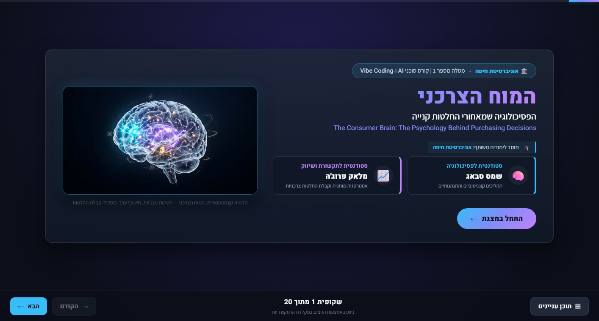
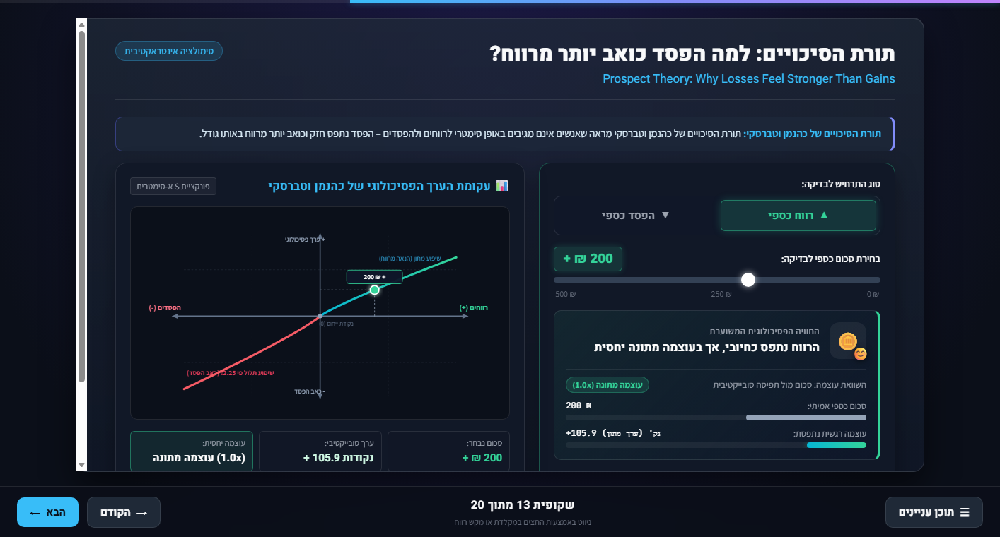
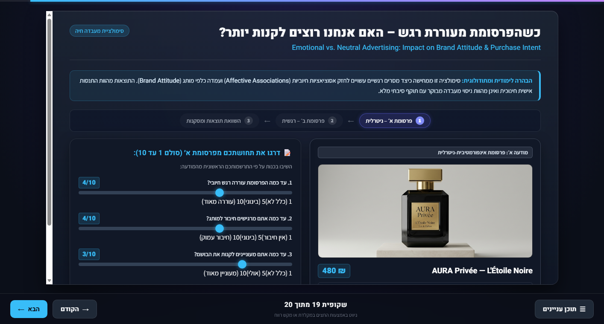
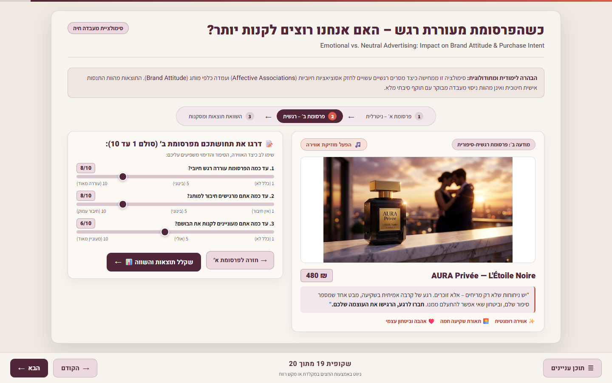
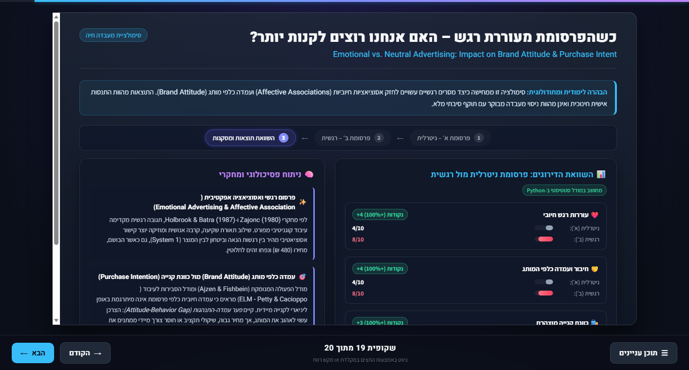

# המוח הצרכני: הפסיכולוגיה שמאחורי החלטות קנייה
## The Consumer Brain: The Psychology Behind Purchasing Decisions

> **קוד פרויקט:** `SHM-2026`  
> **מוסד אקדמי:** אוניברסיטת חיפה  
> **מסגרת אקדמית:** מטלה מספר 1 | קורס סוכני AI ו-Vibe Coding  
> **צוות המגישות:**  
> - **שמס סבאג** – סטודנטית לפסיכולוגיה, אוניברסיטת חיפה  
> - **מלאק פרוג'ה** – סטודנטית לתקשורת ושיווק, אוניברסיטת חיפה  
> 
> **דרישת סילבוס מפורשת של המרצה:**  
> *"בשורש ה-Repository חובה להציב קובץ README.md. הנחו את ה-LLM לשלב בתוך ה-README צילומי מסך והמחשות ויזואליות מתוך המצגת, הסרטון ותוצרי קוד ה-Python."*

---

## 🎯 מטרת הפרויקט (Project Purpose)

פרויקט **"המוח הצרכני"** מהווה גשר אינטגרטיבי ובינתחומי בין **מדעי המוח והפסיכולוגיה הקוגניטיבית וההתנהגותית** לבין **אסטרטגיות שיווק, פרסום ותקשורת שכנועית**. 

מטרת הפרויקט היא לחשוף, להמחיש ולנתח את המנגנונים המנטליים והמוחיים הבלתי-מודעים המעצבים את בחירות הצרכן בעולם הדיגיטלי והפיזי. באמצעות ממשק מצגת מתקדם בן 20 שקופיות, מעבדות אינטראקטיביות בזמן אמת, מודל תלת-ממדי של המוח, מוזיקה פרוצדורלית ומנוע חישוב Python מלא הרץ ישירות בדפדפן (Pyodide WebAssembly), הפרויקט מפרק הטיות קוגניטיביות מרכזיות, בוחן את יעילותם של מסרים רגשיים מול עובדתיים, ומציב זרקור אתי וביקורתי על הגבול הדק שבין דחיפה מיטיבה (<bdi>Nudge</bdi>) לבין מניפולציה מסחרית (<bdi>Dark Patterns</bdi>).

---

## 📸 צילומי מסך והמחשות ויזואליות מתוך המצגת (Visual Showcase & Live Slides)

כלל צילומי המסך להלן נלכדו ישירות מתוך המצגת הפועלת בזמן אמת (`index.html`), ללא עיבוד מלאכותי או תמונות דמה, וממחישים את העושר הוויזואלי, האינטראקטיבי והמדעי של הפרויקט:

### 1. שקופית 1 – מסך הפתיחה ושער הפרויקט (Welcome & Team Identity)

*מסך השער של הפרויקט המציג את כותרת המחקר, שיוך שוויוני לשתי הסטודנטיות (שמס סבאג – פסיכולוגיה, מלאק פרוג'ה – תקשורת ושיווק) תחת אוניברסיטת חיפה, תמונת Hero נוירו-שיווקית מרהיבה (`consumer_brain_hero.jpg`), כפתור התחלת מצגת וסרגל ניווט עליון עם בקרת שמע ותוכן עניינים.*

---

### 2. שקופית 8 – מודל מוח תלת-ממדי אינטראקטיבי ב-WebGL (Three.js 3D Brain)

*הדמיה תלת-ממדית חיה של מוח האדם המרונדרת בזמן אמת בדפדפן באמצעות Three.js. המודל מבוסס על ענן של 2,800 חלקיקים נוירונליים זוהרים, מאפשר סיבוב חופשי של 360 מעלות בעכבר ובמגע, ומציג 4 מוקדים מוחיים אינטראקטיביים (PFC, אמיגדלה, אינסולה, NAcc) עם כרטיסיות הסבר וצלילי תדרים ייחודיים.*

---

### 3. שקופית 9 – מעבדת אפקט המחסור ו-FOMO (The Scarcity Effect Lab)

*מעבדת A/B השוואתית הבוחנת את השפעת רמזי דחיפות ומלאי מוגבל על הצרכן. בניסוי מוצג תיק עור שחור יוקרתי (`MAISON VENDÔME`). בצילום המסך מוצג מצב ב׳ עם התרעת המחסור הבולטת ("נותרו רק 2 יחידות במלאי!"), 3 מחווני דירוג אישיים (רצון לרכוש, דחיפות, FOMO) ומנוע Python המחשב ברקע את מכפיל המחסור.*

---

### 4. שקופית 10 – פרדוקס הבחירה: ניסוי שעון עצר דיגיטלי חי (The Paradox of Choice)

*ניסוי אינטראקטיבי בזמן אמת הממחיש את תופעת עומס היתר (<bdi>Choice Overload</bdi>). סבב 1 מציג בחירה ממוקדת מתוך שלישיית בשמי יוקרה, בליווי **שעון עצר דיגיטלי מדויק** הפועל בלייב (`performance.now()`). בסבב 2 מתמודד הצרכן עם קטלוג עמוס של 12 בשמים בעיצוב Obsidian & Gold, ומנוע ה-Python מנתח את היחס בין זמני ההחלטה ($T_2 / T_1$) ורמות התסכול.*

---

### 5. שקופית 13 – תורת הסיכויים: עקומת S אינטראקטיבית וחישוב שווי (Prospect Theory)

*המחשה גרפית אינטראקטיבית של פונקציית הערך הא-סימטרית של כהנמן וטברסקי ($v(x)$). הממשק כולל בורר רווח/הפסד ומחוון סכום כספי (₪0–₪500). שינוי הסכום מזיז בזמן אמת נקודה זוהרת לאורך עקומת ה-SVG, ומנוע ה-Python מחשב את הערך הפסיכולוגי וממחיש שכאב ההפסד חזק פי ~2.25 מעונג הרווח המקביל.*

---

### 6. שקופית 14 – סימולציית אפקט העיגון, חישוב Python וגרף שווי (Anchoring Effect)

*סימולציה מדעית של היוריסטיקת העיגון וההתאמה. המשתמש מכוון את מחוון מחיר העוגן (₪400–₪1,200), ובלחיצה על "🎯 בדקו את השפעת המחיר" מופעלת נוסחת השווי ב-CPython WebAssembly (Pyodide). צילום המסך מציג את תג האימות של Python, מדדי ההפרש והעלייה באחוזים, וגרף עמודות השוואתי הממחיש כיצד מחיר הייחוס מעלה את השווי הנתפס של המוצר.*

---

### 7. שקופית 19 – מעבדת פרסום רגשי מול ניטרלי: השוואת שתי המודעות ותוצאות (Emotional Advertising)
במעבדה זו מוצג ניסוי תלת-שלבי מובנה להשוואת פרסומת עובדתית מול פרסומת רגשית-סיפורית עבור אותו בושם יוקרתי (`AURA Privée`, ₪480):

| פרסומת א׳ – ניטרלית ועובדתית | פרסומת ב׳ – רגשית, סיפורית ורומנטית |
| :---: | :---: |
|  |  |
| *תאורת סטודיו מאוזנת, מפרט טכני יבש, ללא מוזיקה וסיפור.* | *תאורת שקיעה, מסר רגשי של ביטחון וקרבה, וכפתור מוזיקת אווירה ייעודי.* |

#### שלב התוצאות והגרף ההשוואתי (שקופית 19, שלב 3):

*גרף עמודות השוואתי תלת-מדדי המופק על ידי מודל Python סטטיסטי. הגרף מנתח את הפערים ברגש חיובי (+100%), חיבור למותג (+100%) וכוונת קנייה (+100%), ומציג ניתוח מעמיק של פער העמדה-התנהגות (<bdi>Attitude-Behavior Gap</bdi>).*

---

## 🎬 אנימציית התלת-ממד והשמע הסינתטי (3D WebGL & Web Audio API)

### 1. מנגנון האנימציה ב-Three.js WebGL (שקופית 8)
- **רינדור חלקיקים בזמן אמת:** האנימציה אינה קובץ וידאו מוקלט מראש אלא **סביבת תלת-ממד חיה (Interactive WebGL Canvas)** המרונדרת בזמן אמת ב-60 פריימים לשנייה באמצעות ספריית Three.js המקומית (`js/vendor/three.min.js`).
- **מבנה גיאומטרי:** המוח מורכב מ-2,800 נקודות גיאומטריות (`THREE.BufferGeometry` עם חלקיקי `THREE.Points`) המפוזרות בהתפלגות אליפטית המדמה את שתי המיספרות המוח והקורטקס.
- **תנועה ואינטראקטיביות:**
  - סיבוב אוטונומי עדין המגיב לגרירת עכבר ומגע (OrbitControls אלגנטי).
  - בלחיצה על כפתורי 4 האזורים (PFC, אמיגדלה, אינסולה, NAcc), המצלמה מתמקדת באזור הנבחר, החלקיקים באותו מוקד משנים את צבעם וזוהרים בעוצמה גבוהה, ונפתחת כרטיסיית מידע פסיכולוגית מפורטת.
- **הבהרה מתודולוגית לגבי סרטון (Video Clarification):**  
  > [!NOTE]  
  > המצגת מבוססת על **אנימציה אינטראקטיבית מלאה בקוד (In-Browser Live WebGL Animation)** ולא על קובץ וידאו שטוח (MP4/WebM). הבחירה ברינדור חי מאפשרת לכל צופה, מרצה ובודק לסובב את המוח, לבחור אזורים בחופשיות ולשמוע את הצלילים הייחודיים ישירות בדפדפן.

### 2. סינתזת סאונד פרוצדורלית ב-Web Audio API (`js/audio.js`)
- **ללא קובצי MP3 חיצוניים:** כלל הצלילים במצגת מופקים באופן מתמטי וסינתטי בזמן אמת באמצעות ה-Web Audio API של הדפדפן (אוסצילטורים, מסננים ומעטפות Gain).
- **תדרי האזורים המוחיים:** בלחיצה על מוקד מוחי מושמע צליל בתדר המותאם לפונקציה הפסיכולוגית שלו:
  - **PFC (קליפת המוח הקדם-מצחית):** גל סינוס הרמוני צלול (528 Hz - "תדר הבהירות") המבטא ניתוח רציונלי.
  - **Amygdala (אמיגדלה):** גל מסור (Sawtooth) חד ומודולציית רטט (180 Hz) המבטא דחיפות ואזעקה.
  - **Insula (אינסולה):** תדר נמוך מהדהד (110 Hz) עם פילטר Low-Pass המבטא עומס וכאב תשלום.
  - **NAcc (גרעין האקומבנס):** ארפג'יו משולש עולה (440–660–880 Hz) המבטא דופמין ועונג תגמול.
- **מוזיקת רקע Ambient:** מוזיקת אווירה עתידנית, רגועה ופרוצדורלית המופעלת בלחיצה על אייקון הרמקול בסרגל העליון (או במודעת הבושם הרגשית בשקופית 19), המשלבת פדים חמים והד מרחבי ללא הפרעה לרצף ההרצאה.

---

## 🐍 תוצרי מנוע ה-Python ואימות ביצוע (Pyodide WebAssembly Engine)

### 1. כיצד פועל המנוע המדעי בדפדפן?
בפרויקט הוטמע מנוע **Pyodide WebAssembly** המאפשר הרצת סביבת **CPython v3.11** תקנית ישירות בתוך הדפדפן של הלקוח, ללא צורך בהתקנת שרת Backend חיצוני:
- קוד ה-Python נטען ומקומפל פעם אחת ברקע (`js/python_runner.js`).
- הנתונים מהממשק (ערכי סליידרים, זמני סטופר, בחירות צרכן) מועברים כארגומנטים לפונקציות ה-Python.
- ה-Python מבצע את החישובים המתמטיים, הסטטיסטיים והמודלים ההתנהגותיים, ומחזיר אובייקט תוצאה מובנה המעדכן את הגרפים ומדדי ה-DOM.

### 2. דוגמת קוד Python אמיתי מתוך המערכת (שקופית 14 – עיגון)
```python
import sys

def calculate_anchoring(base_price, anchor_price):
    """
    חישוב הערכת שווי תחת השפעת מחיר עוגן (שקופית 14).
    נוסחת ההתאמה: Base + 0.3 * (Anchor - Base)
    """
    base = float(base_price)
    anchor = float(anchor_price)
    estimated_val = base + 0.3 * (anchor - base)
    difference = estimated_val - base
    pct_increase = (difference / base) * 100.0 if base > 0 else 0.0

    return {
        "estimated_value": round(estimated_val, 2),
        "difference": round(difference, 2),
        "pct_increase": round(pct_increase, 1),
        "anchor_price": round(anchor, 2),
        "base_price": round(base, 2),
        "python_version": sys.version.split()[0],
        "executed_by": "Pyodide CPython WebAssembly"
    }
```

### 3. פלט מספרי אמיתי שהתקבל מההרצה (עבור עוגן של ₪850 ומחיר בסיס של ₪399)
- **מחיר בסיס (Base Price):** `₪ 399.00`
- **מחיר עוגן שהוצג (Anchor Price):** `₪ 850.00`
- **הערכת שווי מחושבת (Estimated Value):** `₪ 534.30`
- **פער נומינלי (Difference):** `₪ 135.30+`
- **עלייה באחוזים (Percentage Increase):** `33.9%+`
- **מנוע מבצע:** `Pyodide CPython WebAssembly (Python 3.11.3)`

---

### 4. מנגנון האימות לבודקים ומרצים (`verifyPythonExecution`)
כדי להבטיח שקיפות אקדמית מלאה ולהוכיח שהתוצאות מופקות על ידי **מנוע Python אמיתי** ולא באמצעות מוקים או ערכים סטטיים, פותחה פונקציית אימות גלובלית:
1. פתחו את המצגת בדפדפן ולחצו על מקש `F12` לפתיחת ה-Developer Tools.
2. עברו ללשונית **Console** והקלידו:
   ```javascript
   verifyPythonExecution()
   ```
3. הפונקציה מריצה בזמן אמת את כל 6 מודלי ה-Python של המצגת ומחזירה את פלט ה-JSON הבא:

```json
{
  "isPythonRunning": true,
  "runtime": "Pyodide WebAssembly (Client-side)",
  "pythonVersion": "3.11.3",
  "slide9_scarcity_effect": {
    "formula": "Comparative Scarcity Delta (In Stock vs. Only 2 Left)",
    "desireDiff": 4,
    "urgencyDiff": 6,
    "fomoDiff": 5,
    "scarcityMultiplier": 2.52,
    "executedBy": "Pyodide CPython WebAssembly"
  },
  "slide10_choice_paradox": {
    "formula": "Decision Time & Difficulty Delta (3 Options vs. 12 Options)",
    "timeRound1": 3.2,
    "timeRound2": 9.8,
    "diffTime": 6.6,
    "timeRatio": 3.06,
    "diffDifficulty": 5,
    "executedBy": "Pyodide CPython WebAssembly"
  },
  "slide13_prospect_theory": {
    "formula": "v(x) = x^0.88 for gain, -2.25 * (-x)^0.88 for loss (Kahneman & Tversky)",
    "testGain200": 105.9,
    "testLoss200": -238.3,
    "lossAversionRatio": 2.25,
    "lossMessage": "ההפסד נתפס בעוצמה רגשית גבוהה יותר מאשר רווח מקביל",
    "executedBy": "Pyodide CPython WebAssembly"
  },
  "slide14_anchoring": {
    "formula": "399 + 0.3 * (850 - 399)",
    "result": 534.3,
    "difference": 135.3,
    "pctIncrease": 33.9,
    "executedBy": "Pyodide CPython WebAssembly"
  },
  "slide16_dark_patterns": {
    "formula": "Autonomy & Transparency Gap + Default Effect Delta (Johnson & Goldstein 2003)",
    "storeA_autonomy": 100,
    "storeB_autonomy": 35,
    "autonomyGap": 65,
    "defaultOptInProb": "84%",
    "priceDifference": 49,
    "executedBy": "Pyodide CPython WebAssembly"
  },
  "slide19_emotional_advertising": {
    "formula": "Comparative Multi-Dimensional Delta & Attitude-Behavior Gap",
    "emotionDiff": 4,
    "brandDiff": 4,
    "intentDiff": 3,
    "attitudeIntentGap": 1,
    "executedBy": "Pyodide CPython WebAssembly"
  }
}
```

---

## 📊 סקירה מקיפה של 20 השקופיות (Slides Overview)

המצגת בנויה במבנה פדגוגי הדרגתי ומדויק בן **20 שקופיות בדיוק**:

| # | כותרת השקופית | נושא מרכזי | סוג תוכן ומדיה | רכיבים אינטראקטיביים ומנועים |
| :-: | :--- | :--- | :--- | :--- |
| **1** | **המוח הצרכני** | פתיח, שער, זהות צוות שוויונית ושיוך לאוניברסיטת חיפה | Hero Image (`consumer_brain_hero.jpg`) | כפתור התחלת מצגת, ניווט ישיר |
| **2** | **מבוא וגבולות המדע: מיתוס מול מציאות** | מתודולוגיה אקדמית, שלילת מיתוסים נוירו-שיווקיים | כרטיסיות השוואת מיתוס מול עובדה | קריאה מובנית, עיצוב Glassmorphism |
| **3** | **מודל שתי המערכות: אינטואיציה מול שיקול דעת** | <bdi>Dual-Process Theory: System 1 & System 2</bdi> (כהנמן וטברסקי) | תרשים וקטורי (`dual_system.svg`) | המחשה תהליכית של אינטואיציה מול ניתוח |
| **4** | **קשב חזותי וסלקטיביות** | <bdi>Visual Attention & Eye-Tracking</bdi>, תבנית סריקה F | מפת חום וקטורית (`visual_attention_heatmap.svg`) | ניתוח מוקדי עניין במסחר מקוון |
| **5** | **תפיסה ועיבוד חושי** | <bdi>Sensory Marketing</bdi> – השפעת חושים על תפיסת איכות | גלגל חושים (`sensory_wheel.svg`) | המחשת התאמה רב-חושית במיתוג |
| **6** | **רגשות וסמנים סומטיים בהחלטות** | תיאוריית הסמנים הסומטיים (<bdi>Antonio Damasio</bdi>) | תרשים וקטורי (`somatic_marker.svg`) | ניתוח תגובות גופניות מקדימות |
| **7** | **זיכרון ואסוציאציות מותג** | רשתות אסוציאטיביות ושליפה מהזיכרון הסמנטי | מפת רשת (`brand_associative_network.svg`) | ניתוח עוצמת קשרים מותגיים |
| **8** | **הדמיה תלת-ממדית: מפת המוח הקונספטואלית** | מיפוי אזורי מוח מרכזיים בקבלת החלטות צרכניות | **מודל תלת-ממדי אינטראקטיבי (Three.js WebGL)** + תרשים (`hero_brain_diagram.jpg`) | סיבוב חופשי 360°, כפתורי שליטה, מיקוד ב-4 אזורים (PFC, אמיגדלה, אינסולה, NAcc) |
| **9** | **אפקט המחסור: למה אנחנו ממהרים לקנות?** | <bdi>Scarcity Effect, FOMO</bdi> ותיאוריית ההתנגדות | תצלום יוקרה מסחרי (`luxury_handbag.jpg`) | **מעבדת A/B אינטראקטיבית** + 3 מחווני דירוג + גרף השוואה + **מנוע Python (Pyodide)** |
| **10** | **פרדוקס הבחירה: האם יותר אפשרויות משמחות יותר?** | <bdi>Choice Overload & Analysis Paralysis</bdi> (שוורץ, איינגאר) | תצלומי בישום (`perfume_trio.jpg`, `perfumes_collection_12.jpg`) | **ניסוי שעון עצר דיגיטלי חי (Live Stopwatch)** (3 מול 12 אפשרויות) + דירוגי קושי + **מנוע Python** |
| **11** | **אפקט הפיתיון ופרדוקס הבחירה** | <bdi>The Decoy Effect (Asymmetric Dominance)</bdi> | דיאגרמה וקטורית (`decoy_effect.svg`) | ניתוח הוספת חלופה נחותה להטיית העדפה |
| **12** | **השפעה והוכחה חברתית** | <bdi>Social Proof</bdi> והפחתת אי-ודאות (<bdi>Cialdini</bdi>) | איור וקטורי (`social_proof.svg`) | ניתוח רמזים נורמטיביים וביקורות המונים |
| **13** | **תורת הסיכויים: למה הפסד כואב יותר מרווח?** | <bdi>Prospect Theory & Loss Aversion</bdi> (כהנמן וטברסקי) | **עקומת S אינטראקטיבית מבוססת SVG** | בורר רווח/הפסד + מחוון סכום (₪0–₪500) + נקודה נעה + חישוב ערך פסיכולוגי $v(x)$ ב-**Python** |
| **14** | **אפקט העיגון: איך המחיר הראשון משפיע עלינו?** | <bdi>Anchoring & Adjustment Heuristic</bdi> | גרף עמודות השוואתי דינמי | מחוון עוגן (₪400–₪1,200) + כפתור חישוב + הרצת נוסחת שווי ב-**Python (Pyodide)** |
| **15** | **כאב התשלום וארנקים דיגיטליים** | <bdi>The "Pain of Paying"</bdi> (פרלק ולוונשטיין) | איור וקטורי (`pain_of_paying.svg`) | ניתוח נטרול פעילות האינסולה בתשלומי 1-Click |
| **16** | **שיווק מבוסס מדע ואתיקה מקצועית** | <bdi>Ethical Marketing vs. Dark Patterns</bdi> | תצלום יוקרה אחיד (`luxury_handbag.jpg`) | **מעבדת Checkout השוואתית** (חנות הוגנת מול מניפולטיבית) + מודאל Confirmshaming + שאלת אבחון + **מנוע Python** |
| **17** | **סוכני AI ועתיד ההחלטות הצרכניות** | <bdi>AI Agents, Machine Customers & Hyper-Personalization</bdi> | דיאגרמת מעגל החלטה (`ai_decision_loop.svg`) | ניתוח עתידני של סוכנים אוטונומיים |
| **18** | **סיכום ותובנות יישומיות** | אינטגרציה מעשית לאנשי שיווק ולצרכנים ביקורתיים | כרטיסיות סיכום מודולריות | עקרונות יישומיים להגברת מודעות ואמון |
| **19** | **כשהפרסומת מעוררת רגש – האם נקנה יותר?** | פרסום רגשי מול עובדתי, <bdi>Attitude-Behavior Gap</bdi> | צילומי מוצר רשמיים של <bdi>Gritti Tutù</bdi> (`gritti_tutu_01.jpg`, `gritti_tutu_03.jpg`) *(סרטוני הפרסומת עדיין בהפקה וטרם שולבו במצגת)* | **מעבדת A/B דו-שלבית ("דרגו את הרושם")** + תוויות ניטרליות לפני דירוג + הגרלת סדר אקראי + אישור דירוג מפורש (כולל אמצע `5/10`) + גרף השוואה + **מנוע Python** |
| **20** | **ביבליוגרפיה, קרדיטים ומקורות** | מקורות מחקריים מאומתים, רישוי חזותי וקרדיטים | כרטיסיות ביבליוגרפיה מובנות | סקירת ספרות אקדמית מלאה ורישוי נכסים |

---

## 💻 פירוט הטכנולוגיות שבשימוש (Technologies Used)

1. **HTML5 Semantic & BIDI/RTL Architecture:**
   - מבנה סמנטי של 20 שקופיות מובחנות (`<section class="slide" id="slide-X">`).
   - התאמה מלאה לכיווניות עברית (`dir="rtl"`) ובידוד מונחים אקדמיים באנגלית באמצעות תגיות `<bdi>`.
2. **Modern CSS3 (Design System):**
   - שימוש במשתני עיצוב מרכזיים (CSS Custom Properties).
   - עיצוב כהה ועתידני (Dark Luxury Glassmorphism) עם שכבות שקיפות וטשטוש (`backdrop-filter: blur`).
   - אנימציות מעבר חלקות ועימוד רספונסיבי מותאם לכל גודלי המסכים.
3. **Vanilla JavaScript (ES6+ Modular Architecture):**
   - 9 סקריפטים מודולריים נקיים ללא ספריות כבדות (Zero external runtime bloat):
     - `presentation.js` – בקר שקופיות, ניווט מקלדת, מגע, TOC והיסטוריית URL.
     - `audio.js` – מנוע סינתזת קול ומוזיקה מרחבית.
     - `brain3d.js` – בקר מודל המוח התלת-ממדי.
     - `python_runner.js` – מנהל סביבת Pyodide WebAssembly והרצת 6 מודלי Python.
     - `scarcity_sim.js` – לוגיקת מעבדת אפקט המחסור (שקופית 9).
     - `choice_paradox.js` – לוגיקת ניסוי פרדוקס הבחירה והסטופר (שקופית 10).
     - `prospect_theory.js` – לוגיקת תורת הסיכויים ועקומת ה-SVG (שקופית 13).
     - `ethical_marketing.js` – לוגיקת שיווק אתי ומודאל ה-Confirmshaming (שקופית 16).
     - `emotional_ad.js` – לוגיקת מעבדת הפרסום הרגשי (שקופית 19).
4. **Three.js WebGL Engine (`js/vendor/three.min.js`):**
   - ספרייה מקומית בתצורת Offline מלאה לרינדור גרפי תלת-ממדי מואץ חומרה.
5. **Web Audio API Synthesizer:**
   - סינתזת סאונד פרוצדורלית בזמן אמת (Warm Pads, Ethereal Arpeggios, Feedback Delays, Dynamic Filters).
   - ללא קובצי MP3 חיצוניים, ללא בעיות זכויות יוצרים, ותאימות מלאה לדפדפנים מודרניים.
6. **Pyodide WebAssembly (Client-side CPython v3.11):**
   - הרצת קוד Python תקני ישירות בתוך הדפדפן של הלקוח.
   - 6 פונקציות ניתוח מדעיות הפועלות ברקע ללא הצגת קוד גולמי לצופים.
   - מנגנוני Fallback אלגנטיים ב-JavaScript המבטיחים פעולה רציפה גם בהיעדר רשת.

---

## 🚀 הוראות מדויקות להפעלת הפרויקט (How to Run)

הפרויקט בנוי לפעולה עצמאית ומיידית ללא צורך בהתקנת שרת מקומי (Zero Setup):

1. **פתיחת המצגת:**
   - הורידו או שכפלו את המאגר (`git clone` או הורדת ZIP).
   - לחצו לחיצה כפולה על הקובץ [`index.html`](file:///c:/Users/shams/OneDrive/Documents/GitHub/SHM-2026/index.html) לפתיחה בכל דפדפן מודרני (**Microsoft Edge, Google Chrome, Mozilla Firefox**).
2. **מקשי ניווט ובקרה:**
   - `חץ שמאלה` / `רווח` / `Page Down` – מעבר לשקופית הבאה.
   - `חץ ימינה` / `Page Up` – חזרה לשקופית הקודמת.
   - `Home` – קפיצה לשקופית הפתיחה (שקופית 1).
   - `End` – קפיצה לשקופית הביבליוגרפיה (שקופית 20).
   - `Esc` – סגירת תוכן העניינים או חלונות קופצים.
   - מגע במסכי מגע: החלקת אצבע ימינה/שמאלה (<bdi>Swipe</bdi>).
3. **שליטה בשמע:**
   - לחצו על אייקון הרמקול בסרגל העליון כדי להפעיל או להשתיק את מוזיקת הרקע (ברירת המחדל היא השתקה מלאה בהתאם לתקני הדפדפן).
   - ניתן לכוונן את עוצמת השמע באמצעות מחוון הווליום.
4. **בדיקת מנוע ה-Python בקונסול הדפדפן (לבודקים ומרצים):**
   - לחצו על מקש `F12` (או `Ctrl + Shift + I`) ועברו ללשונית **Console**.
   - הריצו את הפקודה:
     ```javascript
     verifyPythonExecution()
     ```
   - יוצג אובייקט JSON המאשר ומאמת את פעולת CPython WebAssembly עבור כל 6 המודלים המדעיים במצגת.

---

## 🖼️ נכסים חזותיים מרכזיים (Visual Assets)

כל הנכסים החזותיים נשמרים מקומית תחת תיקיית `assets/images/`:
- [`consumer_brain_hero.jpg`](file:///c:/Users/shams/OneDrive/Documents/GitHub/SHM-2026/assets/images/consumer_brain_hero.jpg) – תמונת שער נוירו-גרפית מרשימה לשקופית 1.
- [`hero_brain_diagram.jpg`](file:///c:/Users/shams/OneDrive/Documents/GitHub/SHM-2026/assets/images/hero_brain_diagram.jpg) – תרשים מבנה המוח לשקופית 8 (וגרסת גיבוי ל-Three.js).
- [`luxury_handbag.jpg`](file:///c:/Users/shams/OneDrive/Documents/GitHub/SHM-2026/assets/images/luxury_handbag.jpg) – תצלום מסחרי יוקרתי של תיק עור שחור ופרזול זהב עבור שקופיות 9 ו-16.
- [`perfume_trio.jpg`](file:///c:/Users/shams/OneDrive/Documents/GitHub/SHM-2026/assets/images/perfume_trio.jpg) – שלישיית בשמי יוקרה על שיש כהה לסבב 1 של פרדוקס הבחירה (שקופית 10).
- [`perfumes_collection_12.jpg`](file:///c:/Users/shams/OneDrive/Documents/GitHub/SHM-2026/assets/images/perfumes_collection_12.jpg) – קטלוג 12 בשמים יוקרתיים לסבב 2 של פרדוקס הבחירה (שקופית 10).
- [`gritti_tutu_01.jpg`](assets/images/gritti_tutu_01.jpg), [`gritti_tutu_02.jpg`](assets/images/gritti_tutu_02.jpg), [`gritti_tutu_03.jpg`](assets/images/gritti_tutu_03.jpg) – צילומי המוצר הרשמיים של **Gritti Tutù (`Extrait de Parfum, 100 ml, SKU: DGB00600`)** מתוך הקולקציה הלבנה (*White Collection*) של בית הבישום **Gritti Fragrances (Gritti Venetia)**, שהורדו מהגלריה הרשמית (`https://www.grittifragrances.com/products/tutu-dgb00600`) ומשמשים בשקופית 1 ובשקופית 19 תוך שמירה מלאה על פרופורציות הבקבוק והתווית המקורית.
- [`perfume_neutral.jpg`](file:///c:/Users/shams/OneDrive/Documents/GitHub/SHM-2026/assets/images/perfume_neutral.jpg) ו-[`perfume_emotional.jpg`](file:///c:/Users/shams/OneDrive/Documents/GitHub/SHM-2026/assets/images/perfume_emotional.jpg) – קובצי ארכיון מהגרסה הקודמת (הוחלפו בשקופיות 1 ו-19 בצילומי המוצר הרשמיים של `Gritti Tutù`).
- דיאגרמות וקטוריות מקוריות בפורמט SVG לשקופיות 3, 4, 5, 6, 7, 11, 12, 15, 17.

---

## 📂 תיעוד תהליך הפיתוח (Prompts Documentation)

בתיקיית `prompts/` שמור תיעוד מפורט של כל שלבי העבודה והפרומפטים ששימשו בפיתוח:

1. [`01_PRD_Planning.md`](file:///c:/Users/shams/OneDrive/Documents/GitHub/SHM-2026/prompts/01_PRD_Planning.md) – אפיון דרישות המוצר, סילבוס השקופיות ומטרות הפרויקט.
2. [`02_Presentation_Skeleton.md`](file:///c:/Users/shams/OneDrive/Documents/GitHub/SHM-2026/prompts/02_Presentation_Skeleton.md) – הקמת שלד ה-HTML, מערכת העיצוב ב-CSS ומנגנון הניווט.
3. [`03_Visuals_And_Slide1_Update.md`](file:///c:/Users/shams/OneDrive/Documents/GitHub/SHM-2026/prompts/03_Visuals_And_Slide1_Update.md) – יצירת נכסים חזותיים ושדרוג שקופית השער.
4. [`04_ThreeJS_Brain.md`](file:///c:/Users/shams/OneDrive/Documents/GitHub/SHM-2026/prompts/04_ThreeJS_Brain.md) – פיתוח מודל מוח תלת-ממדי מבוסס חלקיקים ב-Three.js בשקופית 8.
5. [`05_Audio_Improvements.md`](file:///c:/Users/shams/OneDrive/Documents/GitHub/SHM-2026/prompts/05_Audio_Improvements.md) – שדרוג מערכת השמע ואיזון צלילי האזורים המוחיים.
6. [`06_Ambient_Music.md`](file:///c:/Users/shams/OneDrive/Documents/GitHub/SHM-2026/prompts/06_Ambient_Music.md) – פיתוח מוזיקת רקע Ambient עתידנית ב-Web Audio API.
7. [`07_Python_Anchoring.md`](file:///c:/Users/shams/OneDrive/Documents/GitHub/SHM-2026/prompts/07_Python_Anchoring.md) – הטמעת מנוע Pyodide WebAssembly וחישוב אפקט העיגון בשקופית 14.
8. [`08_Anchoring_UI.md`](file:///c:/Users/shams/OneDrive/Documents/GitHub/SHM-2026/prompts/08_Anchoring_UI.md) – ליטוש ממשק אפקט העיגון, ניקוי קוד גולמי ושמירה על חישוב רקע אמיתי.
9. [`09_Prospect_Theory_UI.md`](file:///c:/Users/shams/OneDrive/Documents/GitHub/SHM-2026/prompts/09_Prospect_Theory_UI.md) – פיתוח סימולציית תורת הסיכויים ועקומת S בשקופית 13.
10. [`10_Emotional_Advertising.md`](file:///c:/Users/shams/OneDrive/Documents/GitHub/SHM-2026/prompts/10_Emotional_Advertising.md) – פיתוח מעבדת הפרסום הרגשי מול הניטרלי בשקופית 19.
11. [`11_Slide1_Final_Update.md`](file:///c:/Users/shams/OneDrive/Documents/GitHub/SHM-2026/prompts/11_Slide1_Final_Update.md) – עדכון סופי של שקופית 1: שמות הסטודנטיות, שיוך לאוניברסיטת חיפה ותמונת Hero.
12. [`12_Scarcity_Effect.md`](file:///c:/Users/shams/OneDrive/Documents/GitHub/SHM-2026/prompts/12_Scarcity_Effect.md) – פיתוח מעבדת אפקט המחסור ו-FOMO בשקופית 9.
13. [`13_Choice_Paradox.md`](file:///c:/Users/shams/OneDrive/Documents/GitHub/SHM-2026/prompts/13_Choice_Paradox.md) – פיתוח ניסוי פרדוקס הבחירה והסטופר הדיגיטלי בשקופית 10.
14. [`14_Ethical_Marketing_Dark_Patterns.md`](file:///c:/Users/shams/OneDrive/Documents/GitHub/SHM-2026/prompts/14_Ethical_Marketing_Dark_Patterns.md) – פיתוח מעבדת שיווק אתי ודפוסי חושך בשקופית 16.
15. [`15_Final_Project_Review.md`](file:///c:/Users/shams/OneDrive/Documents/GitHub/SHM-2026/prompts/15_Final_Project_Review.md) – סקירה סופית ומקיפה, בקרת איכות (QA) ותיעוד פרויקט לקראת הגשה.
16. [`16_PRD_Upgrade.md`](file:///c:/Users/shams/OneDrive/Documents/GitHub/SHM-2026/prompts/16_PRD_Upgrade.md) – שדרוג מקיף ואקדמי של מסמך אפיון דרישות המוצר ([`PRD.md`](file:///c:/Users/shams/OneDrive/Documents/GitHub/SHM-2026/PRD.md) גרסה 2.0).
17. [`17_README_Visuals_Screenshots.md`](file:///c:/Users/shams/OneDrive/Documents/GitHub/SHM-2026/prompts/17_README_Visuals_Screenshots.md) – שילוב צילומי מסך אמיתיים, המחשות ויזואליות, הסבר אנימציית Three.js ושמע, ותיעוד תוצרי Python ואימות CPython WebAssembly.
18. [`18_Slide19_Improvement_Plan.md`](prompts/18_Slide19_Improvement_Plan.md) – תיעוד תוכנית השיפורים המדורגת לשקופית 19 ([תוכנית שיפור שקופית 19](docs/slide19-improvement-plan.md)).
19. [`19_Stage1_Slide19_Python_Conversion.md`](prompts/19_Stage1_Slide19_Python_Conversion.md) – שלב 1 בתוכנית השיפור לשקופית 19: המרת תוצאות ה-Python (`Map`) לאובייקטי JavaScript רגילים ב-`calculateEmotionalAdPython` ואימות מול מנגנון הגיבוי.
20. [`20_Visual_Redesign_Pilot_Slides1_And_19.md`](prompts/20_Visual_Redesign_Pilot_Slides1_And_19.md) – תכנון הכיוון העיצובי העריכתי החדש ([תוכנית עיצוב מחדש ל-20 השקופיות](docs/visual-redesign-plan.md)) ומימוש פיילוט בשקופיות 1 ו-19 בלבד (פלטת שנהב חם `#F7F3ED`, בורדו עמוק `#502638`, סומק בהיר `#EBD9DF`, קורל `#D85B49` ופחם `#252329`; שקופיות 2–18 ו-20 מתוכננות ומסומנות כ-`PLANNED`).
21. [`21_Gritti_Tutu_Slide19_And_Content_Audit.md`](prompts/21_Gritti_Tutu_Slide19_And_Content_Audit.md) – עדכון שקופית 19 לבושם האמיתי והמאומת **Gritti Tutù (`Extrait de Parfum, 100 ml, € 260`)** (עם סימון מפורש של התמונות הקיימות כממלאי מקום זמניים לפיתוח), מימוש זרימת החשיפה הדו-שלבית (`"דרגו את הרושם"`), תוויות ניטרליות לפני דירוג (`מודעה א׳` / `מודעה ב׳`), הגרלת סדר הצגה אקראי, דרישת אישור מפורש לכל דירוג (כולל בחירת נקודת האמצע `5/10` ללא הזזת מחוון), תוכנית 3 קונספטים לצילום המודעה הרגשית, וביקורת דיוק עובדתי ומחקרי לכל 20 השקופיות ([`docs/content-audit.md`](docs/content-audit.md)).
22. [`22_Slide19_Hybrid_Video_And_3D_Plan.md`](prompts/22_Slide19_Hybrid_Video_And_3D_Plan.md) – תכנון חוויה היברידית לשקופית 19 ([`docs/video-ad-production-plan.md`](docs/video-ad-production-plan.md), סטטוס: `PLANNED — AWAITING BOTTLE REFERENCE ASSETS`): שני סרטוני פרסומת פוטוריאליסטיים בנקודת מבט קבועה (~25 שניות כל אחד: מודעה עובדתית מול מודעה רגשית *"Before they call your name"* עבור **Gritti Tutù**) לצד מציג מוצר תלת-ממדי אינטראקטיבי נפרד ב-Three.js עם בקרת סיבוב (`OrbitControls`). המסמך מפרט בכנות כי סביבת העבודה הנוכחית אינה מייצרת קובצי וידאו (`.mp4`) או מודלים תלת-ממדיים (`.glb`) מאומתים בעצמה, מגדיר את צילומי הייחוס הנדרשים של הבקבוק המקורי, ושומר על פעולתה התקינה של שקופית 19 הקיימת עד להפקת הנכסים.
23. [`23_Official_Gritti_Tutu_Images_Integration.md`](prompts/23_Official_Gritti_Tutu_Images_Integration.md) – הורדת צילומי המוצר הרשמיים של **Gritti Tutù (`Extrait de Parfum, 100 ml, SKU: DGB00600`)** מתוך עמוד המוצר הרשמי (`https://www.grittifragrances.com/products/tutu-dgb00600`) אל `assets/images/gritti_tutu_01.jpg`, `assets/images/gritti_tutu_02.jpg` ו-`assets/images/gritti_tutu_03.jpg`, החלפת תמונות ממלא המקום (`AURA`) בשקופית 1 ובשקופית 19 תוך שמירה מלאה על פרופורציות הבקבוק והתווית (`object-fit: contain`), תיעוד הקרדיט בשקופית 20, ודחיית מודל ה-3D של הבקבוק עד להשגת זוויות ייחוס מספקות (תוך שימור מלא של סצנת המוח התלת-ממדית בשקופית 8).
24. [`24_Workflow_Audit_And_Checkpoint.md`](prompts/24_Workflow_Audit_And_Checkpoint.md) – ביקורת תהליך השמירה, התיעוד ודרישות המטלה הזמינות במאגר, הפרדה ברורה בין עבודה שהושלמה, עבודה מתוכננת ועבודה שטרם נבדקה, תיעוד כי סרטוני הפרסומת לשקופית 19 עדיין בתהליך הפקה וטרם שולבו במצגת, ויצירת Checkpoint מתועד בענף `malak-improvments`.
25. [`25_Lecturer_Requirements_Audit.md`](prompts/25_Lecturer_Requirements_Audit.md) – ביקורת מקיפה של הפרויקט מול 9 דרישות המרצה בסיכום שיעור 2 (סעיף 11, עמודים 21–23) במסמך [`docs/lecturer-requirements-checklist.md`](docs/lecturer-requirements-checklist.md), אימות האנימציה התלת-ממדית ב-Three.js (`js/brain3d.js`) וביצוע קוד ה-Python האמיתי (`js/python_runner.js`) בהבחנה ממנגנון הגיבוי ב-JavaScript, עדכון [`PRD.md`](PRD.md) (גרסה 2.1), ותיעוד נוהל העבודה האוטונומי והמחייב לכל אבן דרך.
26. [`26_Mandatory_Technical_Foundation_Verification.md`](prompts/26_Mandatory_Technical_Foundation_Verification.md) – בדיקה ואימות אוטומטי של התשתית הטכנית המחייבת בכל 20 השקופיות (`js/presentation.js`), סצנת ה-Three.js התלת-ממדית בשקופית 8 (`js/brain3d.js`), והרצת Python אמיתית (`Python 3.11.9`) בכל 6 השקופיות המבוססות על Python (`9, 10, 13, 14, 16, 19`); תיקון המרת תוצאות Pyodide (`Map` לאובייקטי JS רגילים) גם בשקופיות 9, 10, 13 ו-16 (`js/python_runner.js`, `js/prospect_theory.js`), תיקון יחס רוחב-גובה (`aspect`) התחלתי של המצלמה ב-`js/brain3d.js` כששקופית 8 מוסתרת בטעינה, ומניעת חטיפת מקשי חצים/רווח על ידי מנוע הניווט בזמן הזזת סליידרים ב-`js/presentation.js`.

---

## ⚠️ מגבלות ידועות והערות מתודולוגיות (Known Limitations)

1. **טעינת Pyodide ברשת מול סביבה מנותקת:**
   - ספריית Pyodide נטענת מ-CDN (`cdn.jsdelivr.net`). בעת הפעלה ראשונית בסביבה נטולת אינטרנט לחלוטין, מנועי החישוב עוברים אוטומטית למנוע גיבוי ב-JavaScript (<bdi>Client Fallback</bdi>) המחשב את התוצאות במדויק מבלי להציג שגיאות למשתמש.
2. **מדיניות השמע של דפדפנים (Autoplay Policy):**
   - דפדפנים מודרניים חוסמים השמעת אודיו אוטומטית לפני אינטראקציה יזומה. לכן, כלל הצלילים ומוזיקת הרקע מושתקים כברירת מחדל ומופעלים אך ורק בלחיצה מפורשת של המשתמש.
3. **הבחנה בין סימולציה לימודית למחקר מעבדה:**
   - הדירוגים והמדידות בסימולציות (מחסור, פרדוקס הבחירה, פרסום רגשי) נועדו להמחיש עקרונות פסיכולוגיים למשתתף יחיד, ואינם מהווים ניסוי אמפירי מבוקר בעל מובהקות סטטיסטית. הדבר מצוין בהבלטה בכל שקופית אינטראקטיבית.
4. **סטטוס עבודה נוכחי בענף `malak-improvments` (הבחנה בין מה שהושלם לבין מה שבתהליך/מתוכנן/טרם נבדק בדפדפן חי):**
   - **הושלם ואומת אוטומטית (Node.js + Local HTTP + Real Python 3.11.9):** ניווט מלא בכל 20 השקופיות וטעינת כל 27 הנכסים המקומיים (`HTTP 200`); לוגיקת האנימציה והבקרה של סצנת המוח התלת-ממדית ב-Three.js בשקופית 8; הרצת Python אמיתית והזנת הפלט לממשק בכל 6 השקופיות המבוססות על Python (`9, 10, 13, 14, 16, 19`); פיילוט העיצוב העריכתי החם (`#F7F3ED` / `#502638`) בשקופיות 1 ו-19; שילוב צילומי המוצר הרשמיים של **Gritti Tutù (`Extrait de Parfum, 100 ml, € 260, SKU: DGB00600`)** (`gritti_tutu_01.jpg`, `gritti_tutu_02.jpg`, `gritti_tutu_03.jpg`); ואימות חישובי שקופית 19 עבור דירוגים שווים, דירוג גבוה יותר למודעה העובדתית ודירוג גבוה יותר למודעה הרגשית.
   - **דורש אימות ידני קצר בדפדפן גרפי (Live GUI Browser Check):** צפייה ויזואלית ברינדור WebGL על גבי כרטיס המסך בשקופית 8 (`#slide-8`) ואימות הורדת Pyodide מ-CDN בקונסול הדפדפן (`verifyPythonExecution()`).
   - **בהפקה / מתוכנן (טרם שולב במצגת):** שני סרטוני הפרסומת לשקופית 19 (~25 שניות כל אחד, המפורטים ב-[`docs/video-ad-production-plan.md`](docs/video-ad-production-plan.md)) **עדיין נמצאים בהפקה וטרם שולבו בקוד המצגת**. מציג הבקבוק התלת-ממדי ב-Three.js נדחה עד להשגת זוויות ייחוס מספקות של הבקבוק (ללא טענה לדיוק מילימטרי ללא מדידות מאומתות). כמו כן, החלת העיצוב העריכתי החדש ותיקוני ביקורת התוכן ([`docs/content-audit.md`](docs/content-audit.md)) על שקופיות 2–18 ו-20, וכן לכידת צילומי מסך חדשים ב-`docs/screenshots/` עבור שקופיות 1 ו-19 המעודכנות, מסומנים כ-`PLANNED`.
   - **נוהל עבודה ו-Checkpoints:** במהלך העבודה נשמרים כל הקבצים והפרומפטים בזמן אמת, ולאחר כל אבן דרך (Milestone) שהושלמה ונבדקה נוצר Checkpoint מתועד ב-Git בענף `malak-improvments`.

---

## 📚 מקורות אקדמיים מאומתים (Academic References)

- **Ariely, D. (2008).** *Predictably Irrational: The Hidden Forces That Shape Our Decisions*. HarperCollins.
- **Brignull, H. (2010).** *Dark Patterns: Deception vs. Honesty in UI Design*. A List Apart.
- **Cialdini, R. B. (2006).** *Influence: The Psychology of Persuasion*. Harper Business.
- **Damasio, A. R. (1994).** *Descartes' Error: Emotion, Reason, and the Human Brain*. Putnam.
- **Holbrook, M. B., & Batra, R. (1987).** Assessing the role of emotions in consumer response to advertising. *Journal of Consumer Research*, 14(3), 404-420.
- **Iyengar, S. S., & Lepper, M. R. (2000).** When choice is demotivating: Can one desire too much of a good thing? *Journal of Personality and Social Psychology*, 79(6), 995-1006.
- **Johnson, E. J., & Goldstein, D. (2003).** Do defaults save lives? *Science*, 302(5649), 1338-1339.
- **Kahneman, D. (2011).** *Thinking, Fast and Slow*. Farrar, Straus and Giroux.
- **Kahneman, D., & Tversky, A. (1979).** Prospect Theory: An Analysis of Decision under Risk. *Econometrica*, 47(2), 263-291.
- **Petty, R. E., & Cacioppo, J. T. (1986).** The Elaboration Likelihood Model of persuasion. *Advances in Experimental Social Psychology*, 19, 123-205.
- **Prelec, D., & Loewenstein, G. (1998).** The red and the black: Mental accounting of savings and debt. *Marketing Science*, 17(1), 4-28.
- **Schwartz, B. (2004).** *The Paradox of Choice: Why More Is Less*. Ecco / HarperCollins.
- **Thaler, R. H., & Sunstein, C. R. (2008).** *Nudge: Improving Decisions About Health, Wealth, and Happiness*. Yale University Press.
- **Tversky, A., & Kahneman, D. (1974).** Judgment under Uncertainty: Heuristics and Biases. *Science*, 185(4157), 1124-1131.
- **Worchel, S., Lee, J., & Adewole, A. (1975).** Effects of supply and demand on ratings of object value. *Journal of Personality and Social Psychology*, 32(5), 906-914.
- **Zajonc, R. B. (1980).** Feeling and thinking: Preferences need no inferences. *American Psychologist*, 35(2), 151-175.
